## Atari Sparrow resource page

This is my collection of Sparrow-related resources. So far it's only the overview of its revisions and serial numbers but I have many photos and most importantly, two working units in my possession so I plan to update it in near future.

### Sparrow revisions

There had been two revisions manufactured: rev.1 (usually on a hand-written label without the actual "rev.1" written) and rev.2 (more or less profesionally looking PCB).

The following list has been compiled from various Internet sources (eBay auctions, forum posts, computer history pages, ...). Sometimes I had to extract the PCB s/n from its case s/n - although I'm fairly sure that the "algorithm" is correct, I do place a note where such s/n is presented.

As far as I know, only rev.2 PCB had its case available. The cases I have been able to find so far:
- A3 25 11 0010 09 (printed as "A3 25 11 00100 9")
- A3 25 11 0010 11
- A3 25 11 0010 13
- A3 25 11 0010 15
- A3 25 12 0010 23
- A3 26 12 0010 33
- A3 26 13 0010 34
- A3 26 13 0010 35
- A3 26 13 0010 45

The fourth number (from the right) serves as an ID for the PCB (x=0) and case (x=1), as does the eighth number (1 = case, 3 = PCB).

#### rev.1:
- A3 22 23 0000 04
- A3 22 23 0200 06
- A3 2? 23 0000 07 (? is missing, perhaps a typo as it's hand written?)
- A3 23 23 0000 13 (hand-written as "A3 23 23 00013")
- A3 24 23 0000 17

#### rev.2:
- A3 24 33 0000 03 (printed as "A3 24 33 00000 3")
- A3 25 31 0000 08
- A3 25 31 0000 09
- A3 25 31 0000 11 ("calculated" from the case s/n A3 25 11 0010 11)
- A3 25 31 0000 13
- A3 25 31 0000 15
- A3 25 32 0000 23
- A3 25 32 0000 25
- A3 26 32 0000 32
- A3 26 32 0000 33 ("calculated" from the case s/n A3 26 12 0010 33)
- A3 26 33 0000 34
- A3 26 33 0000 35
- A3 26 33 0000 37
- A3 26 33 0000 40
- A3 26 33 0000 45 ("calculated" from the case s/n A3 26 13 0010 45)
- A3 26 33 0000 48
- A3 26 33 0000 58
- A3 26 33 0000 59
- A3 26 34 0000 50
- A3 26 34 0000 53

It would seem there were three batches of both rev.1 (02/1992, 03/1992 and 04/1992) and rev.2 (04/1992, 05/1992 and 06/1992). Meaning of the second digit in "3x" is not clear, perhaps NTSC/PAL-I/PAL-B/PERITEL but that's just a guess. For what it's worth, the Falcon030 main board did exist in exactly these four variants: NTSC, PAL-I, PAL-B and Peritel.[^f030serv]

### Number of Sparrows produced

This makes only 17 (rev.1) + 59 (rev.2) = 76 publicly known Sparrows in the world (assuming the numbering had restarted for rev.2). Actually, there were three Sparrow board without any serial number for sale, so that makes it 79.

_Anfang 1992 wurde der Prototyp des Atari Falcon einigen Entwicklern präsentiert. Etwa 150 Vorserienmodelle wurden dann Mitte des selben Jahres an europäische Entwickler ausgeliefert. Einige dieser Rechner trugen das Label FX-1 wärend auf anderen der Name Sparrow prangte. Der Festplattentreiber des Prototyps meldete sich beim Booten mit "Sparrow" und benutzte den Blitterchip für den Datentransfer zur IDE Festplatte. Auf dem Board wurde ein TOS 4.00 in 2 Megabit großen DIL Eproms als Betriebssystem eingesetzt. In einer frühen Entwicklungsstufe war es sogar ein TOS 2.07, welches die VDI Routinen für die Bildschirmausgabe von Platte nachlud._

_The Atari FX-1, or "Sparrow", is also a prototype machine. Actually, it is almost a Falcon030. It has all its features except its true color mode (not fully implemented in the FX-1) and the PCM sound channels (12 bit instead of 16 in the Falcon)._

_These computers used the Atari Mega STe TOS (2.06) slightly modified to cope with the new graphic modes. This TOS version had the number 2.07 and was replaced in the last Sparrow models with the TOS 4.0 (The Falcon used TOS 4.01 in the earlier models, then the 4.04 and finally the 4.92 (never released))._

_Atari produced less than 100 of these machines. They were built with sample spare parts and were used by developpers to write software for the future Atari Falcon._

### Sparrow resources

The first four documents were found & rescued by [Christian Zietz](https://www.chzsoft.de) and first published at [atari-home.de](https://forum.atari-home.de/index.php/topic,13380.msg214172.html#msg214172):

- [Sparrow specification (dated Dec 18 1991)](sparrow_specification_19911218.md) (converted into markdown by me)
- [(Incomplete) Sparrow schematics (dated Mar 12 1991 - Sep 13 1991: Moshe Segal, John Horton)](sparrow_schematics_19910312.pdf) (converted into PDF by Christian)
- [Falcon specification (dated Dec 3 1991)](falcon_specification_19911203.pdf) (converted into PDF by Christian)
- [Falcon specification (dated Aug 26 1992)](falcon_specification_19920826.md) (converted into markdown by me)
- [Sparrow schematics (dated Jan 19 1992)](sparrow_schematics_19920119.pdf) (recovered by Wizztronics)
- [(Incomplete) Microbox gerber file](microbox_gerber.pdf) (assembly and fab drawings of the "FALCON030/MICROBOX" board, rev 1)
- [Microbox PCB](microbox-pcb-color.pdf) (the layers of the same board)
- [Falcon040 stencil](falcon040.png) (artwork of the "FALCON 040" board C302697-001, rev 2)
- [Microbox bill of materials (dated 02-05-1993)](microbox_bom_19930205.txt) (the original file has corrupted item numbers and quantities; quantities recounted from the reference designators)
- [A History of Tramel Technology / Atari](https://mcurrent.name/atarihistory/tramel_technology.html) by Michael Current, a detailed and well-sourced timeline of Atari Corp. (including the Sparrow, Falcon030 and Falcon040)

### Sparrow vs. Falcon030 vs. Falcon vs. Microbox vs. Falcon040

Interestingly, there were *four* 32-bit machines (excluding the TT) developed (at various stage of completion) by Atari Corp. And their stories are much more intertwined than their names would suggest.

See  also the related thread on [atari-forum.com](https://www.atari-forum.com/viewtopic.php?p=310452).

A lot of what follows comes from an archive of Marty Pennock's files from Atari Microsystems in Dallas, Texas. Marty worked in the Dallas product engineering group and wrote service guides, among them the Sparrow / FALCON030 one; the files span Oct'91 - Oct'92 (weekly status reports, memos, faxes, specifications, diagnostics source code and drawings). Footnotes marked [_TECHPUBS_](techpubs/TECHPUBS.zip) point to the files in [this archive](techpubs/). [I let Claude to summarise](techpubs/claude_harness.tar.gz) *all* of them into a human-readable story, I think it did a pretty good job with a lot of interesting facts. Documents without a date of their own are dated by their files in the archive. A few details come from Atari's TOS sources, rebuilt in the [tos4x](https://github.com/mikrosk/tos4x) repository (footnotes marked _TOS4X_), and from the source code of the Falcon030 diagnostic cartridge and of the Falcon040 monitor.

#### 1991: two teams, two computers

In 1991 Atari worked on two new computers on two different continents.

Dallas became Atari's hardware workshop at the turn of the decade. In early 1990 Atari had "recently taken over a custom chip designer in Dallas" and was moving part of the ST development there, and in March 1991 Jack Tramiel spoke of "a 45-strong development team" working in Dallas "on a whole range of new products". Richard Miller had already set the goal at the Atari Messe of Aug 1990: DSPs, graphics coprocessors and improved DMA chips as standard in the new generation - "by the end of 1991 you will find all these functions in computers costing under 1000 dollars".[^dallas]

The **Falcon** was the project of the "FALCON Design Team, Atari Microsystems" in Dallas, Texas, with John D. Horton Jr. as its contact. Its specification goes back to the definition of its "FBUS" from Oct 22 1990 and a first draft from Jan 4 1991, and it grew out of the TT: its main chapter opens with the same sentences as the TT specification of 1989 and its "IO Control Unit" is the TT's "System Control Unit" under a new name.[^falconspec][^ttspec] The draft of Dec 1991 describes a 68030 (with a 68882) or a 68040 at up to 33 MHz, a VMEbus, up to 32 MB of fast RAM, packed pixel ("chunky") modes with up to 24 bits per pixel and a "Powerful graphics coprocessor" whose chapter says just "Information to be supplied by Martin Brennan". It was "intended for use with Atari's TOS operating system or the UniPlus+ V.4" and questions about its mechanical design were to be directed to Steven Chan and Ira Valenski (the [former ST/FM designer](http://www.computinghistory.org.uk/det/587/Atari-520-STM)).[^falconspec]

In this magazine excerpt dated Jul'91 one can clearly recognise the TT/VME-based Falcon which had been in the works. Sam Tramiel had let the name slip two weeks earlier ("Today we have the Falcon, the STE and the Mega STE"), Atari UK's PR spokesman "believed Falcon was simply the American name for the TT machine" and Atari UK's managing director Bob Gleadow described "a TT type machine with a slightly higher price point (the TT currently costs £1,880). It'll have more Virtual Machine Environment (VME) slots, more processing power and more ports than the TT". It was to be launched with developers later in 1991 and to ship in mid-1992.[^nce91] Only the CD-I drives which the magazine was so excited about never made it into the specification.[^falconspec]

[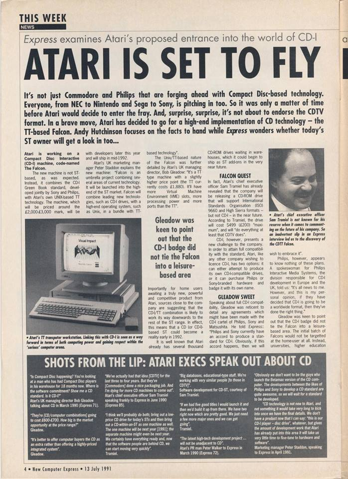{: width="340"}](91_falcon1.jpg) [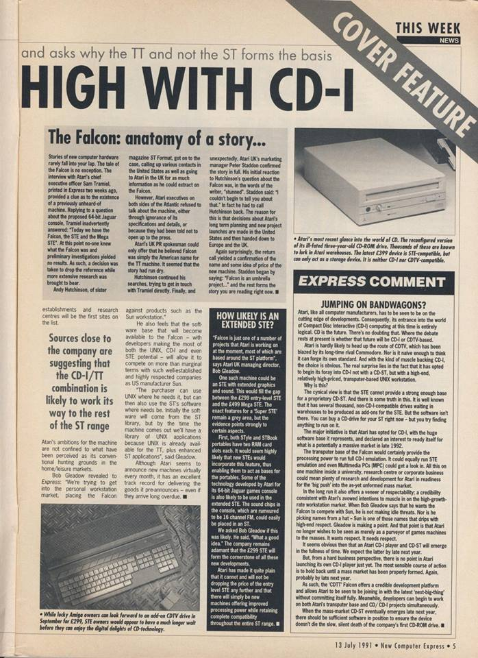{: width="340"}](91_falcon2.jpg)

*New Computer Express of Jul 13 1991, pages 4 and 5*

The **[Sparrow](https://web.archive.org/web/20211118104428/https://www.maedicke.de/atari/hardware/sparrow.htm)** came from Atari Israel: Moshe Segal and Eran Dariel wrote its specification and chip specifications, and Dallas later faxed its questions to "Moshe Segal, Atari Israel".[^sparrowspec][^israel] Atari Israel was Atari Computers Ltd. in Herzliya, a small research and development operation set up on Oct 8 1989 and headed by Gideon Amir, the founder of Advanced Semiconductor Technology, with Eran Dariel as its project manager - and it reported to Richard Miller, Atari's VP Technology.[^mcurrent] There were rumours that it began its life as a set of daughterboards for the STE to increase its sound and graphics capabilities - with the SDMA, COMBEL and STE Shifter (which would later become the VIDEL) respectively.

The oldest Sparrow drawings show a computer of its own, but one with a lot of STE in it.[^sch91] Two of the five sheets of Atari Israel's "SPARROW MOTHERBOARD" from Mar 12 1991 survived: they have the STE chips "GSTMCU" and "GSTSHFTR", the latter fed with 25 MHz and 32 MHz clocks, and a "VGA 15 PIN ANALOG CONNECTOR". The floppy circuit, the ST's DMA chip and a WD1772, sat on a plug-in "DMABRD" (Apr 4 1991). The next DMA board, the "SPARROW DMA II CKT" of Aug-Sep 1991, was drawn in Dallas, by John Horton, the contact of the Falcon team. It has a DMA chip with sound and Microwire pins, the "AJAX" floppy controller, a 5380 SCSI controller and the "RASCAL" sound chip with an "EXTERNAL DIGITAL SOUND" connector - so in 1991 the Sparrow's DMA, SCSI and sound were still a separate board, and the Falcon team's contact was already working on it.

The [gallery](gallery/index.html) has a photo of a board which it describes as an STE PCB, with three cards plugged in: one called "DMABRD" as well, a "VIDEO" card and an "ATARI COMBEL ADAPTOR". That fits the rumour, and so does the magazine above. There Bob Gleadow said that "Falcon is just one of a number of projects that Atari is working on at the moment, most of which are based around the ST platform"; the magazine guessed that "One such machine could be an STE with extended graphics and sound" and Gleadow answered just "What a good idea."[^nce91] Whether such cards were ever meant to be sold as an STE upgrade, nobody said.

[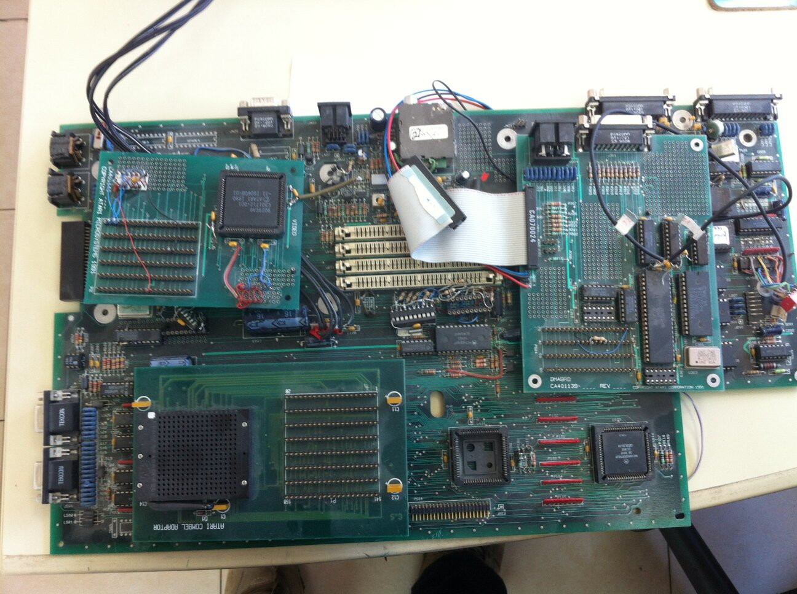{: width="600"}](gallery/1/post-35790-0-41587700-1369897090.png)

*From the gallery: a board with the "DMABRD" (CA401139, right), "VIDEO" (top left) and "ATARI COMBEL ADAPTOR" (bottom left) cards; the gallery describes the main board as an STE PCB*

What the chip specifications from late 1991 do show is how much STE is inside the Sparrow. The "Sparrow DMA ASIC Description" (SDMA, Nov 4 1991) contains the ST's DMA chip "converted to an internal cell", now driving a 5380 SCSI controller and the 1772 floppy controller, plus a sound DMA which adds 16-bit stereo to the STE's 8-bit modes.[^sdma1991] The COMBO specification (Dec 19 1991) begins with "The new COMBO chip will be based on the STe COMBO (4153 COMBO)" and keeps its glue logic and Blitter "basically unchanged".[^combo] Its video part (sync generators, light pen) moved together with the STE video shifter into a new video chip, the VIDEL, which promised an "XGA high color mode" with 65,536 colours.[^videl] Eran Dariel's "VTG Cook Book" from Dec 12 1991 explained how to program the new video timing registers, honestly admitting that some of its examples "were not tested yet".[^vtg]

The Sparrow specification itself (rev A10 from Dec 18 1991) shows how the machine grew up. Its change list of Oct 22 1991 replaced ACSI with SCSI, merged the video outputs into "a single VGA type connector" and gave the audio output a "Walkman" jack. A second, undated list follows with "68000 changed to 68030" and "68881 FPU & 56001 DSP added" - while the introduction still speaks about "68000 - based computers". Its sound chip was still the RASCAL, with a 12-bit DAC, an 8-bit ADC and "Digitally controlled tone, volume and fade via microwire".[^sparrowspec]

The 68030 and the DSP came first on a card of their own. Sparrow's diagnostics speak about an "030+DSP sparrow board" on Jan 31 1992 and an "SP030D card" on Feb 3 1992,[^diag] and a drawing called "DSP Board Orientation" from Feb 24 1992 shows a "DSP Board" carrying a "68030 8MHz", a "68882 8MHz" and a "56001 20MHz DSP" with "8k Words SRAM".[^dspboard] A card with these chips survived:

[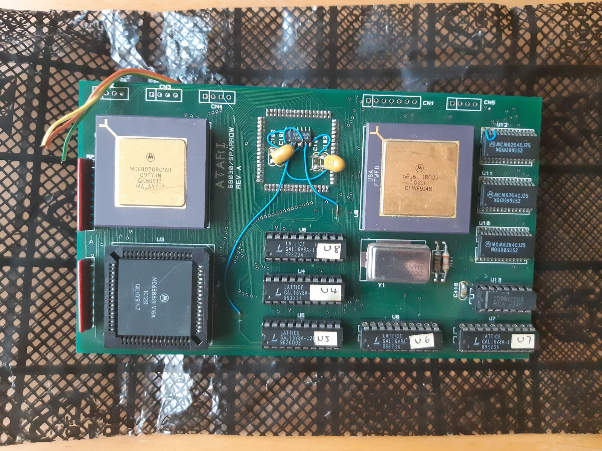{: width="600"}](gallery/18/front.png)

*From the gallery: the "68030/SPARROW REV A" card with a 68030, a 68882, a 56001 DSP and three 8K x 8 SRAMs (MCM6264)*

#### Winter 1991/92: the Sparrow arrives in Dallas

Both machines met on the desks of Atari Microsystems in Dallas, where Marty Pennock wrote weekly reports to Tom Ulaszek. On Nov 25 1991 Dallas asked Atari Israel for "the schematic and a product specification for the Sparrow project", on Dec 12 it "Got schematic for Falcon", a week later the Sparrow specification, and by Jan 9 1992 the first chapters of both the Falcon and the Sparrow service guides were finished.[^israel][^wdec][^wearly92]

The Sparrow proved to be a moving target. Its "schematic changing too much to do a good service guide", the specifications were "not very good. Many holes and information lacking" and the schematic revision A1 "does not match spec".[^wearly92] Richard Miller from Atari Sunnyvale asked for lists of all Sparrow connectors - of the new 19-pin monitor connector Dallas had to admit "The male connector spec does not exist as yet." - and also came over to work on the Sparrow in Dallas.[^spcon][^miller] The Falcon, on the other hand, stayed a paper machine for Dallas: there was "No ASIC documentation for Falcon chips" because "They have not yet been written."[^wearly92]

The mechanical drawings for the case arrived in the first week of February, and the case didn't start from scratch. Its top view and right side are the STE case drawings which Dallas had also used for the STE+ (an STE with a "DOS compatible hardware AT emulator using an 80286 microprocessor"), the left side got two joystick sockets drawn in and only the rear panel was new.[^drawings][^wearly92]

Roy Stedman started the Sparrow's production diagnostics in December 1991 from the STE cartridge - "Started Sparrow Test 0.5 from STe v1.9 (half works)" - and the changelog shows how the hardware kept changing: "NOW ONLY 68030's NEED APPLY" on Jan 31 1992, yet "Hacked up for 68000 Sparrow" on Feb 18.[^diag] Atari's TOS group met the new machine on Dec 4 1991, when Allan Pratt added a machine type to the BIOS makefile: "New machine 12/91: w for Sparrow.  Probably f for Falcon one day."[^tosdec91]

#### Early 1992: the FX-1

In Feb'92 the machine got a hardware reference guide under the name FX-1 (versions 0.3 and 0.4 from Feb 16 and Feb 18 1992, written by "RGM", very likely Richard Miller).[^fx1] A note in it, "Modified from rev A2", refers to the board revision of the recovered schematics from Jan 19 1992: ten sheets of the "SPARROW BOARD", rev A2, from "ATARI COMPUTERS LTD.", engineer S. Rosenberg.[^sch92] The SIMMs were gone, replaced by a "Custom module. 1 to 14 MBytes of RAM", and TOS sat in two 256 KB ROMs. Sound mixed old and new: sixteen bit DMA recording and playback of up to ten tracks, but only 8-bit ADCs, 12-bit DACs and a "Dedicated DSP for volume, treble, bass and scale control" (not the 56001). Microwire was still there, even on pins 1-3 of the new DSP connector, and the serial port was driven by the MFP just like on the ST.[^fx1] The memory board and the internal expansion port already used the 50- and 30-pin connectors every Falcon030 memory board and expansion card uses.[^connectors][^f030prod]

[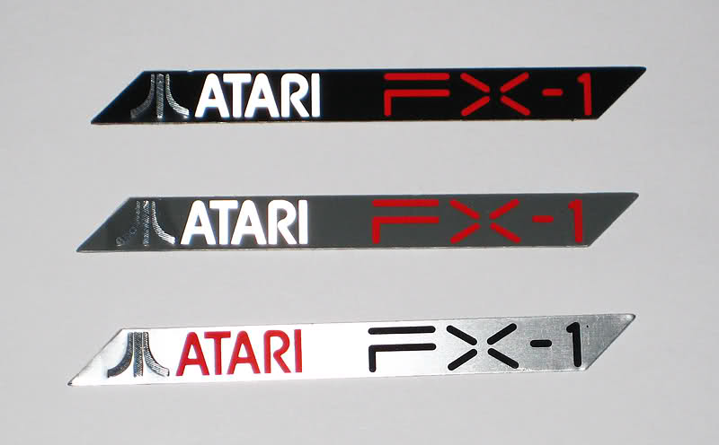{: width="480"}](badges.jpg)

*Three "ATARI FX-1" nameplates*

The first Sparrow rev.1 motherboards were made in Feb'92, and on the first evening of CeBIT in Hannover (Mar 11 1992) the machine had its world premiere at a press evening in the Hotel Maritim - for the press and some selected developers only. Leonard Tramiel started the demo and Jack Tramiel presented in person, as Sam Tramiel was held in the US as a witness in the Nintendo trial. The demo units came in an anthracite 1040 case with yellow key legends, and the machine got its name that evening: the computer "developed under the code name Sparrow is now officially called Falcon 30", and it is "the brother of the Falcon 40, a machine with an MC68040 processor", which was not on show. Alwin Stumpf of Atari Germany explained why it wasn't in the shops yet: "In principle the machine is finished, but our problem is the yield of the custom chips", and Richard Miller, the "chief hardware developer", added: "We worked for a long time on a new custom chip which is of central importance for the Falcon".[^cebit92] (Atari's computers were from now on to be named after birds - unlike its consoles, the Lynx and the Panther, which were cats.[^stm1292]) The new name was ready by then: Tom Le's "FALCON 30 Expansion Test fixture Specification" is dated Feb 28 1992 and Toomey Freeman's "FALCON 030 DIAGNOSTIC SPECIFICATION" Mar 3 1992. Inside it was still the FX-1: the PSG output "is routed to the RASCAL device where it is then conditioned by the Tone and Volume controls sent via the MicroWire bus from the DMA chip".[^diagspec] The power supply specification of the same months still carries the Sparrow name ("117 VAC SPARROW PSU SPECIFICATION", 37.4 W) - and its part number C302866-001 is the one of the Falcon030's 117 V power supply later.[^psu][^f030serv]

#### Spring 1992: developer machines

The rev.2 boards followed from Apr'92 on (judging by their serial numbers) while the COMBEL chip was being revised: the diagnostics "Fixed FPU error w/rev 1 Combel" on Apr 1 1992, "A rev. 1 combel will show mixed and out of order color bars" and the Sparrow's VGA 320x400 XGA mode "DOESN'T WORK W/REV 1 COMBELS".[^diag]

Developers received the Sparrow in a "developer support package". Its introduction (Apr 23 1992) starts with "Welcome to the first developer support package for Sparrow" and describes a machine with 16 MB of RAM and a 40 MB hard disk which could boot from the hard disk only with a boot floppy in the drive ("this will be changed in the next set of ROMs"). It started into a command shell where one could choose between the STE video modes and "two of the many new Sparrow modes" loaded from disk - 320x200 in true colour or in 256 colours - and "For the time being do not use the BLiTTER in 320x200 true color mode."[^devkit] This was the time of TOS 2.07, dated Feb 29 1992: the TOS 2.06 of the STE and the MEGA STE with a new BIOS, which introduces itself as an STE with "Sparrow video" and has no calls for the new video, sound or DSP hardware yet[^tos207] - the "slightly modified" TOS 2.06 of the quotes above, while the new video modes came as "softloaded drivers" on disk.[^devkit] The game guidelines of the same day already used the new name: "Use the Falcon enhanced joystick for all joystick-oriented games; CX-40 style controls should not be supported."[^devkit]

[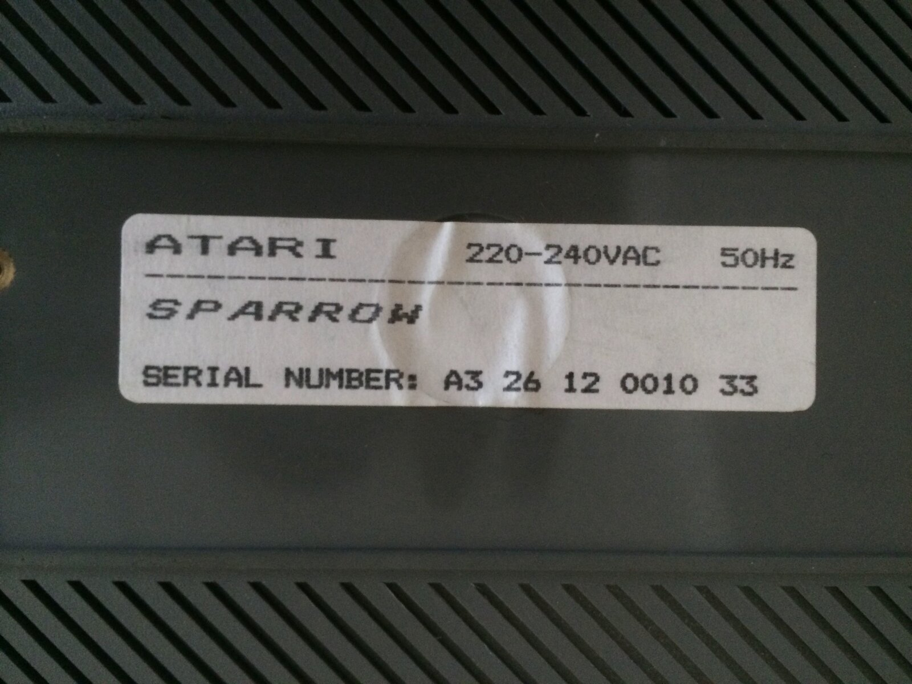{: width="480"}](gallery/2/post-39737-0-42690300-1405020947_rotated.png)

*From the gallery: the type label of a Sparrow for 220-240 V (case s/n A3 26 12 0010 33)*

The "Falcon030 Developer Hardware Release Notes" from Apr 29 1992 never use the name Sparrow and list what the developer machines were still missing.[^hardnote] They had 8-bit ADCs and 13-bit DACs with "VERY poor sound quality" (though "programs like Quartet seem to work OK") while production machines would get a 16-bit codec, and "Microwire has gone away on production machines." An old version of the memory controller prevented true colour in 640 pixels on TVs and in 320 pixels on VGA monitors - the "not fully implemented" true colour of the quote above. The serial port was connected to the MFP instead of the SCC, CPU memory cycles took five clock cycles instead of four and the DSP host port sat at different addresses. Two more differences were left as a puzzle: "I'll buy a beer for the first developer to spot them."

So the production design was settled by the end of April, and the "Falcon030 Hardware Reference Guide" of May 11 1992 already describes it: 16-bit ADCs and DACs, a matrix connecting the DSP, the codec and the DMA, and a serial port "connected to the 85c30 SCC chip (rather than the 68901 MFP as in previous machines)".[^f030hard] The days of the separate CPU card were over by May 18 1992, when Allan Pratt took out a BIOS file because "it was a temporary hack while Sparrows had both CPUs" and noted "all Sparrow is 68030" and "Sparrow doesn't have microwire any more."[^tos68030] In June Richard Miller got drawings from Dallas "for use at developers meeting in UK"[^wsummer] - the AtariEuroDevCon at the Hotel Penta at Heathrow on Jun 27 1992, "exactly eight weeks before the Atari Messe", where Sam Tramiel, Bill Rehbock, Richard Miller and John Skruch met over 120 developers, who went home with a test version of MultiTOS and printed documentation of the Falcon 030 hardware and software.[^mcurrent][^devcon92]

#### Summer 1992: the Sparrow becomes the Falcon030

In the Dallas reports the name changed in June: the first "Falcon030" appears in the weekly report of Jun 11 1992, although "Sparrow" stayed in use for the same documents until Jul 21.[^falcon040][^wsummer] Around the same time the Sparrow lost its birthplace: Atari Computers Ltd. in Israel was closed, its work moved to Dallas (renamed from Atari Microsystems to Atari Computer Corporation on Mar 31) and Gideon Amir and Eran Dariel left the company.[^mcurrent] On Aug 3 1992 Dallas faxed Eran Dariel and Moshe Segal: "As directed by Richard Miller we are in the process of creating an Engineering Archive system at Atari Dallas", asking for everything about the COMBEL, VIDEL and AJAX - "complete in the event the part must be looked at here in detail".[^isr5] Over the summer the Sparrow was turned into a product, with engineers in Dallas and Sunnyvale deeply involved. Dallas had a "rough draft from J. Hoenig that contains many errors" about the SDMA changes with "J. Horton working hard to resolve issues", and in July John Hoenig and Tracy Hall faxed the "latest FALCON030 schematic changes" and Scott Matson delivered new VIDEL and COMBEL specifications.[^wsummer] The engineers had their own views of it. In the diagnostics source code, Roy Stedman commented on the new audio test: "Horton wants to do FFT's on it. I don't."[^diag] And according to Ken Badertscher, the GEMDOS call Srealloc() of Jul 9 1992 "is brought to you by the ingenious wizards who created a machine with a video mode that uses more than 70% of system memory."[^srealloc]

What changed on the way from Sparrow to Falcon030:
- The SDMA grew from 120 to 144 pins and "The MICROWIRE interface has been deleted from the current design". A matrix connected the sound DMA, the DSP, the DSP connector and a codec clocked from 25.175 MHz, the number of tracks went down from 10 to 8, and a new pin told the chip whether a 68030 or a 68000 was the bus master: "Some day (Sparrow++++) this will be an output."[^sdma]
- On the first rev 3 boards the "ASCO CODEC shuts up occasionally while playing" and the solution was to "use Crystal part".[^rev3]
- The COMBEL got a 208-pin package and the serial port moved from the MFP to the 8530 SCC, which the Sparrow had had for the LAN port all along.[^f030serv][^sparrowspec]
- RAM moved to memory boards with 1, 4 or 14 MB and TOS from two ROMs into a single 4 Mbit EPROM.[^f030prod][^fx1][^f030serv]
- The expansion port kept its connectors but got new bus grant signals: "CPUBGI and CPUBGO must be connected together on production machines in order that they work at all", which the factory did with a jumper.[^hardnote][^mfg]
- The keyboards got a COP888 controller, and in the service guide's parts list the UK and French ones are still called "K/B FX-1 W/COP".[^f030serv]
- Even the case got a last touch: on Jul 23-24 1992 the floppy side was redrawn with a new drive bezel, first with the old slanted eject button and a day later with a rectangular one.[^bezel]

The new SDMA can be seen in the gallery, too: one of the Sparrow rev.2 boards carries an "ATARI SDMATEST REV 1" card with a chip labelled by hand "SDMA REV C" and "AT4182A". AT4182 is the number of the SDMA in the Falcon030 production procedure, and an "SDMA ... REV C" is what the Microbox below got.[^mfg][^bom]

[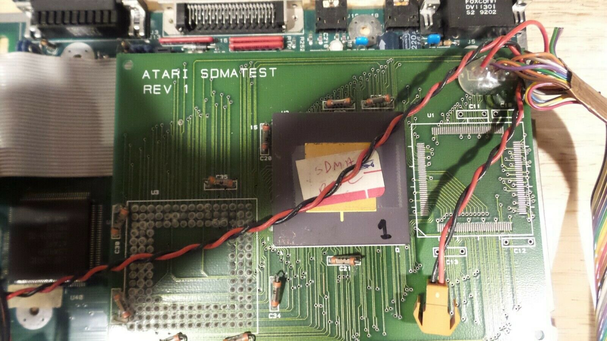{: width="360"}](gallery/22/s-l1600%20%285%29.png) [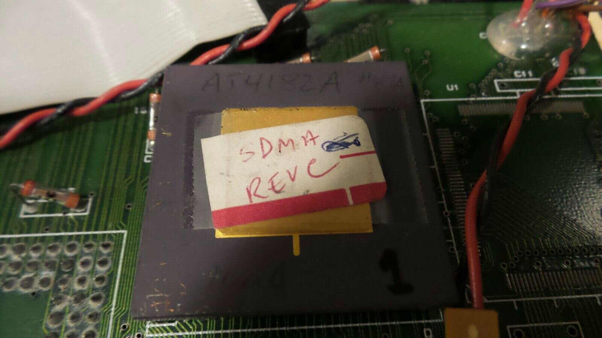{: width="360"}](gallery/22/s-l1600.png)

*From the gallery: the "ATARI SDMATEST REV 1" card on a Sparrow rev.2 board (pcb s/n A3 26 34 0000 53) and its chip*

The diagnostics call the boards "Falcon030, rev 2" and "rev 3". Roy Stedman "Started hacking on it for rev 3. boards" on Jul 9 1992[^diag] and the list of their problems from the next day reads like a typical first batch: shorted address and size lines, audio capacitors shorting the 9 V or 5 V rails "(no solder mask)", a solder short under the DSP's SRAMs, a missing resistor silencing the speaker and an open trace killing the FPU.[^rev3]

The production was prepared in Taiwan. On Jul 13 1992 Marty finished the preliminary FALCON030 product specification - "Despite a problem with my air conditioning unit at home, which took all day Friday to repair" - so that Tom Ulaszek would have "a solid document to go with you to Taiwan". The "FALCON 030 PRODUCTION PROCEDURE" drawn by Jerry Smith is dated Jul 15 and the assembly drawings went "to Jerry Smith in Taiwan" on Jul 29.[^wsummer][^mfg] The drawing of the top case has the "ATARI FALCON030" nameplate.[^f030assy] In the diagnostic source code from Oct 1992, Tom Le "Fixed bugs to run with 6 pilot Falcon030 PCB's" on Aug 3 1992, and the audio test got a "TEMP FOR TAIWAN RUN #1" because "for some reason sound only works occasionally".

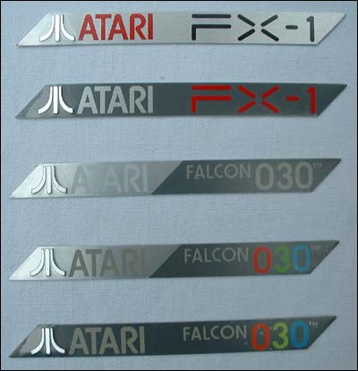

*Two "ATARI FX-1" and three "ATARI FALCON 030" nameplates*

On Jul 8 1992 Atari Germany presented the Falcon at a press conference in Frankfurt, still with a prototype, and announced a 1040-style case in Atari grey and that "a model with a separate keyboard and expansion slots" would follow soon.[^frankfurt92] The "FALCON030 Hardware Product Specification" reached rev B on Aug 10 1992,[^f030prod] the same day Ken Badertscher checked in "TOS 4.00 Falcon030 first production version".[^tos400] Even though the offical [Falcon030](https://web.archive.org/web/20220518155144/https://www.maedicke.de/atari/hardware/falcon.htm) release happened in Aug'92 at Atari Messe in Dusseldorf (with TOS 4.00, in three configurations: 1 MB without a hard disk for 1398 DM, 4 MB with a 65 MB hard disk for 2298 DM and 14 MB with a 65 MB hard disk for 3298 DM[^mcurrent]), Atari magazines got for their September issue only photos of Sparrow's typical dark grey case with white ST/E keyboard and rev.2 motherboard inside. At the Messe Richard Miller explained the hardware, the reworked production board, now entirely in SMD, was shown for the first time, and Sam Tramiel announced: "Production has just started with the first 500 units", to be followed by 1000, 3000 and 10000 - and "next year at least 500,000", with the Falcon 040 "due shortly".[^messe92] A month later all the Atari press were previewing the real Falcon030. In Dallas, Marty Pennock began printing ten copies of the FALCON030 Service Guide on Sep 24 1992 and wrote under the week's plans just "Get a job." (and under its problems "Need a job.").[^pennock] The guide itself is dated Oct 1 1992 - and it still shows "the contents of the Sparrow palette" in its video test.[^f030serv]

But it took several months (as late as Mar/Apr'93!) until the Falcon030 hit the stores due to "insurmountable quality control issues". At its UK launch in September 1992 Atari had predicted that "15,000 Falcons will be sold in the UK between now and the end of the year" and that the case would be "redesigned to give a totally new appearance" before it became "a mass market product next March".[^stuser81] The FCC approval came on Nov 5 1992 and the machine was launched in Germany in November,[^mcurrent] but in February 1993 Jack Tramiel had to admit that of the 5000 Falcons announced for the first quarter "500 arrived just last week".[^tos393] In the UK it shipped in March 1993, in the US it was due "in late March to early April", and by early April about 5,000 Falcon030s had gone to Germany, of which 1,800 were sold.[^mcurrent] This was also the time when the internal HDD got upgraded from 65 MB to 80 MB and TOS from version 4.00/4.01 via 4.02 to 4.04.[^tos40x] And in the end the factory did what Roy Stedman hadn't wanted to do: the diagnostic cartridge of Apr 30 1993 measured the distortion, the signal to noise ratio and the frequency response of both audio channels, and failed a machine whose two channels differed in their frequency response by more than 7%.

So basically the Falcon030 is a bugfixed version of the Sparrow - with a few removals (the Microwire interface, the RASCAL sound chip and the MFP-driven serial port, none of which are present in the Falcon030) but also with a few additions (the codec, the sound matrix and the new expansion port signals).

#### 1992: the Falcon becomes the Falcon040

Meanwhile the Dallas Falcon went its own way. Just before CeBIT '92 the rumour was "a new top model called Falcon: 68040 CPU, 24- or 32-bit graphics card", but "production readiness is not expected within 12 to 18 months. Two of the many custom chips exist only on paper."[^tos392] The service guide chapter written in Dallas in Jan'92 already describes it as a 68040 machine at 33 MHz with VMEbus and a power supply of "Approx 130 watts."[^falconsg] Its first chip specifications, filed in Feb'92, still keep both CPU options open: the IO controller has bus modes for the 030 and the 040, takes "Functions from the TT SCU chip" and creates a bus which "mimics an 8mhz 68000 bus" for the ST compatible peripherals, and the DMA controller records sound from "the RASCAL sound chip" - the sound chip the Sparrow specification names.[^falconasic]

The specification went on with a sixth draft on Feb 21 1992, a "Prototype A release" on Apr 8 1992 and a "Prototype B release" on Aug 26 1992. By then the Falcon had the Falcon030's sound - the 56001 DSP, a codec, the matrix and the 26-pin DSP connector, in sentences taken word for word from the Falcon030's SDMA description. It was now "intended for use with Atari's TOS operating system or ASV", meant to become "a fully-compatible X Windows workstation", and the VMEbus was "not included on all models".[^falconspec] The borrowing went both ways. John Horton handed over the specifications of the Falcon030's SDMA and of the Falcon's "Falcon-A DMA" (ADMA) on the same day in July; the ADMA text says "New to the SDMA ..." and the SDMA text begins with "The Falcon ADMA circuit provides three DMA channels".[^wsummer][^adma][^sdma]

And it got a new name. From Jun'92 on, the Dallas reports talk about the **Falcon040**, and in September Dallas received a "new FALCON040 Product Specification from John Horton" and the "FALCON040 MCU ASIC Specification from Scott Lewis".[^falcon040] The TOS group followed: in July 1992 the BIOS makefile, where Allan Pratt had written "Probably f for Falcon one day", got the machine type "f Falcon/040".[^tosmake] So John Horton was working on the Falcon030 and the Falcon040 at the same time.

The new name is also on a printed circuit board. The artwork of the "FALCON 040" board "C302697-001", "REV 2", carries the Dallas address of the Falcon specification ("4115 KELLER SPRINGS RD #200"). It has seven large pin grid array footprints, two PLCC sockets and seven long sockets which look like memory module or card sockets; I can't find a VME connector on it.[^f040pcb] Its part number lies between the Falcon power supply of the Dec 1991 specification (C302695-001) and the Falcon030 memory boards drawn in Feb 1992 (C302763-001), so it was probably assigned around the turn of 1991/92, when the machine was still just the Falcon - while its rev 2 artwork already says FALCON 040.[^falconspec][^memboards][^pcbno]

[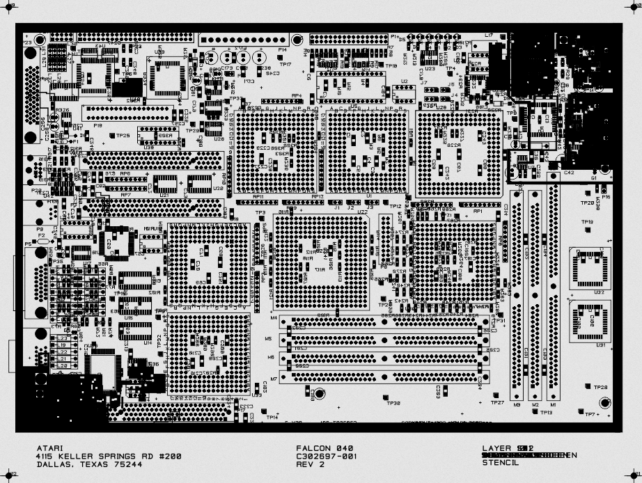{: width="720"}](falcon040.png)

*The artwork of the "FALCON 040" board C302697-001 rev 2 (several layers printed over each other)*

Atari Explorer published a photo of a board with large PGA sockets, white memory sockets and a plugged-in card as the "Falcon040 Motherboard (AHS Collection)"; whether it is the board of this artwork is not clear.[^aex]

[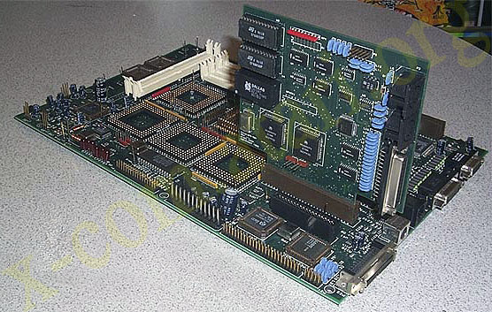](falcon040_board_maedicke.jpg)

*The "Falcon040 Motherboard (AHS Collection)", in the copy from maedicke.de[^maedicke]*

Dallas wrote diagnostics for the Falcon, too, and the whole program survived. Roy Stedman, the author of the Sparrow diagnostics, started his "Simple Monitor for Falcon 040" on Mar 10 1992, the day before the Falcon 40 was announced at CeBIT without being shown. He had spent the evening before on the show itself: "XGA Dawn", a "Dawn of a new generation" demo for the "sparrow (falcon 030)", signed "(C) 1992 Atari Microsystems - Dallas, Texas", with a hopeful "As seen at CeBit (maybe)" in its header.[^f4mon]

About five weeks later the first Falcon040 board came to life on Roy's desk, and he kept a diary of it, the "FALCON PROGRAMMING NOTES" (Apr 14 - Jun 1 1992). It reads like the diary of any first prototype - wires crossed, things working one day and not the next - but some entries were bad news for a machine meant to run ST software ("Compatibility Trouble!"), and for one of them "JH", most likely John Horton, had no fix: "NO WAY AROUND". The board didn't run reliably at its full 33 MHz yet, and a colleague called Greg contributed two test pictures which Roy filed as "GREGSJUNK". Roy burned his monitor into EPROMs on Apr 29 and May 6 and built it for the last time on Jun 16 1992, in the month when the Dallas reports started calling the machine Falcon040.[^f4mon]

So the Falcon040 did run software in the spring of 1992. Roy later told the person who passed on the 1.25 diagnostic sources that it had its problems - with the prototype FPGAs and ASICs and, believe it or not, with sensitivity to light.[^rws040] The Sparrow profited from it, too: Roy's DSP test of the Sparrow from Mar 26 1992 was "Made into Falcon test - uses RAM" on Apr 24, and in August the Sparrow diagnostics got their working DSP tests back from it: "Made DSP SSI & SRAM work (copied from f4dsp.s)".[^diag]

So what became of this Falcon? The "Prototype B release" of Aug 26 1992 is a release of the specification, not proof that a second prototype was built - but under the Falcon040 name the project was still very much alive in Sep'92, right after the Falcon030 was released at Atari Messe. In June Atari had promised the Falcon040 for November 1992, at the Messe Sam Tramiel called it "due shortly", and in September Dallas received its new product specification and archived the FALCON030 and FALCON040 system specifications.[^mcurrent][^falcon040] Then, on Sep 29 1992 - five days after Marty Pennock's "Get a job." - Atari closed the Dallas research and development and production engineering facility with its about 40 employees; Tom Ulaszek left and Jerry Smith became the product engineering manager.[^mcurrent] By the autumn the Falcon040 was off the plan for the year, and no document after that shows any more work on it. So the Falcon040 most likely died with Atari Dallas, which would also explain why Atari never showed at least a prototype.

#### 1993: the Microbox and the Falcon040

Two months after Atari Dallas had closed, the UK press still expected the Falcon040. In ST Format 41 (Dec'92) Andy Hutchinson wrote that the "68040 based Falcon computer" "will almost certainly be released in the third quarter of 1993 in a brand new PC-looking case" for "around £1,000" and that it "was developed alongside Falcon030" - apparently nobody in the UK knew that the team which had developed it was gone. The CD drive belonged to another machine, "an all-in-one CD-Falcon" in "a brand new VCR style case".[^stf41]

[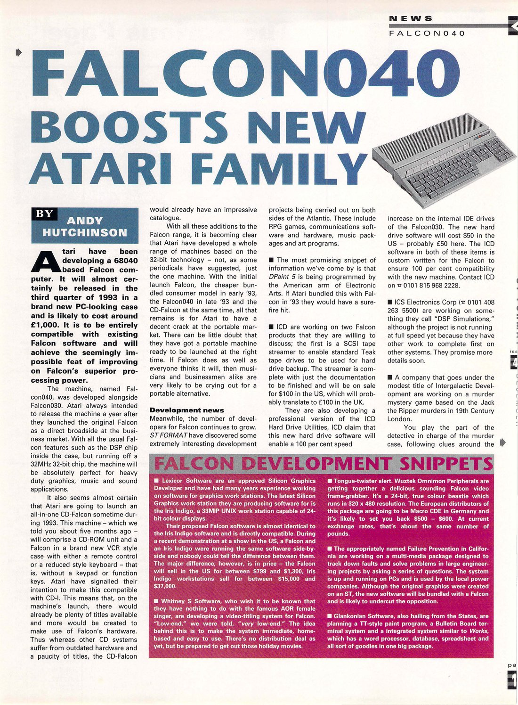{: width="480"}](atari-st-format-issue-041_11.jpg)

*ST Format 41 (Dec 1992), page 11*

The article doesn't mention the [Microbox](https://web.archive.org/web/20221208131609/https://www.maedicke.de/atari/hardware/microbox.htm), a small machine with three 32-bit expansion slots whose design team was headed by Ira Valenski according to atarimuseum.com[^amuseum] - the Ira Valenski of the mechanical design questions in the Falcon specification. Yet the Microbox was no Falcon. The silkscreen of its board reads "ATARI / FALCON030/MICROBOX / REV 1", and its [bill of materials](microbox_bom_19930205.txt) from Feb 5 1993 is the Falcon030 chipset - SDMA rev C, VIDEL rev B, COMBEL rev C and AJAX - with the Falcon030's 16 MHz CPU, the DSP, the codec and TOS 4.02 in a single EPROM, most of them with the same Atari part numbers as in the Falcon030's parts list.[^mbpcb][^bom][^f030serv] What's new is a 72-pin SIMM socket, a socket for the FPU and a 182-pin card edge connector, while there is no SCSI controller, no SCC and no DRAM on the board, and no VME connector either. The Computer History Museum has a "Falcon 030 Microbox board", a gift of Leonard Tramiel.[^mbpcb][^chm]

[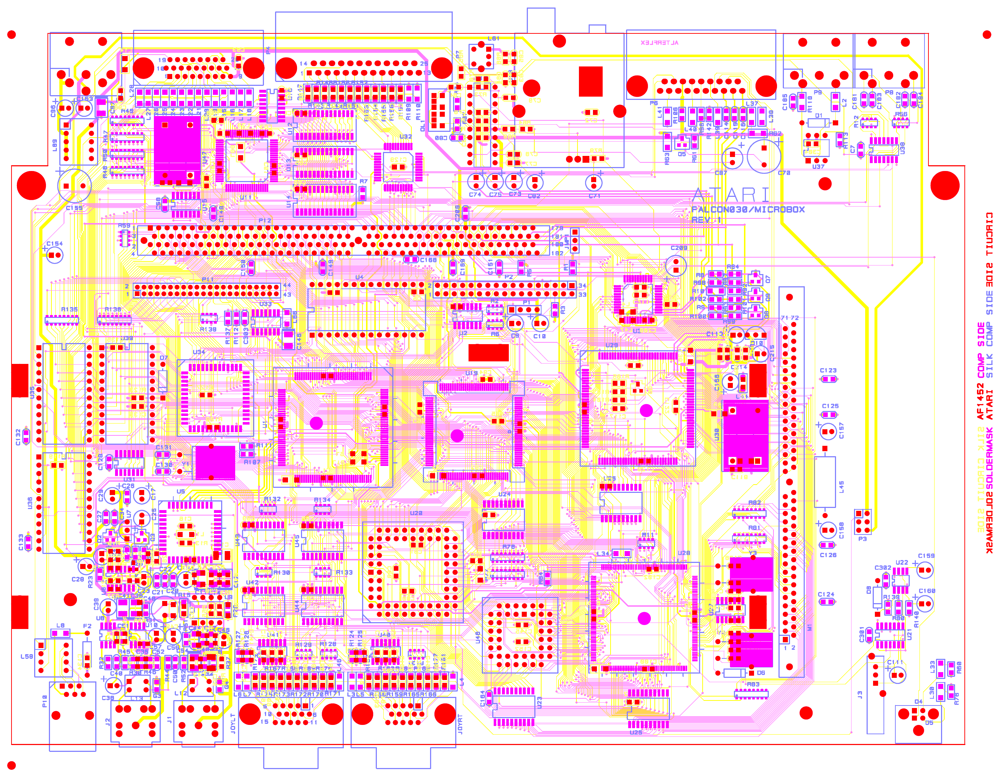{: width="720"}](microbox_pcb_layers.png)

*The "FALCON030/MICROBOX REV 1" board with all its layers, rendered from the [Microbox PCB](microbox-pcb-color.pdf) plots (see also the [component side silkscreen](microbox_pcb_silkscreen.png) and the [gerber plots](microbox_gerber.pdf))*

[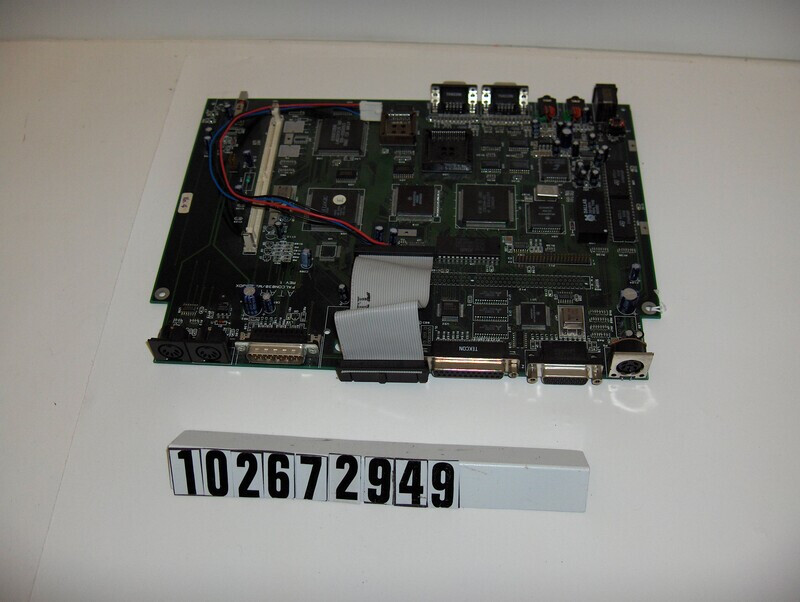{: width="600"}](chm_microbox_board.jpg)

*The real thing: the "Falcon 030 Microbox board" of the [Computer History Museum](https://www.computerhistory.org/collections/catalog/102672949) (object 102672949, gift of Leonard Tramiel), with its "FALCON030/MICROBOX REV 1" silkscreen on the left*

The Microbox was still alive in June 1993, when Eric Smith of Atari's TOS group "Worked on getting software to boot on the Microbox prototype. Created several RAM tests, an updated TOS, and a TOS+DB combination for testing purposes. Helped to track down hardware bugs in Microbox." and two weeks later "Made a diagnostic cartridge ROM for Microbox."[^es] According to some sources Atari had several (at least three) prototypes of the Microbox but the memory controller was buggy; just before the release date its development was abandoned. Leonard Tramiel put it like this in 2001: "The Microbox reached prototype status, but one of the most important custom chips was faulty ... The Falcon 040 didn't even get that far"[^lt2001] - which doesn't match Roy Stedman's notes of a Falcon040 board running his monitor in the spring of 1992.

There are two versions of the Microbox _case_. The floppy disk version is a slim box which can lie flat or stand on a grey stand. In Jason Smith's case the floppy drive sits in one part of the front, and the ribbed part next to it has the openings for the parts along the front edge of the "FALCON030/MICROBOX" board, in the board's order: the RJ12 socket P10, the mini jacks J2 and J1 and the joystick ports JOYLT and JOYRT, with two slits and a small window for the switch J3 and its two LEDs further on. So this case was made for the board above; Atari Explorer shows it as "FALCON 030 MICROBOX". It belonged to the collector Jason Smith, who called it "one of only 3 Falcon Microbox prototypes known to exist".[^mbpcb][^mbphotos][^aex][^jaysmith]

[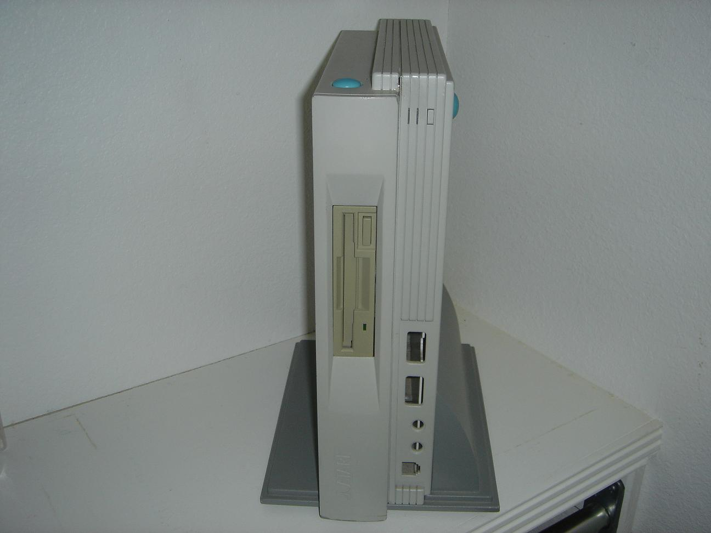{: width="480"}](microbox_floppy.jpg)

*The floppy disk version of the Microbox case on its stand (Jason Smith's collection, Jul 4 2005)*

[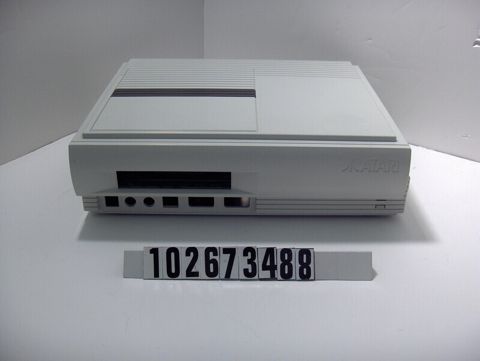{: width="600"}](chm_microbox_case.jpg)

*Another Microbox case: the "Falcon Microbox Case Prototype" of the [Computer History Museum](https://www.computerhistory.org/collections/catalog/102673488) (object 102673488, gift of Leonard Tramiel)*

The Computer History Museum, whose Microbox board and case are both gifts of Leonard Tramiel, catalogues its slim case as the "Falcon Microbox Case Prototype" (circa 1992, 12 x 3.5 x 10 inches).[^chm] It has the same body with the ribbed half on top, but a different front: an empty drive opening and a recessed strip of six openings - a square, two round holes, a small and two wide rectangles - sit side by side, and the Atari logo is at the other end. So the slim Microbox case existed with at least two different front panels.

The CD-ROM version is a larger box with a wide opening on the left of the front, three expansion slots at the back and a round "Monitor Plinth" on its top (photos from atarimuseum.com: [1](microbox_cd1.jpg), [2](microbox_cd2.jpg), [3](microbox_cd3.jpg)).[^amuseum][^maedicke] In a museum display it is the Microbox: "The Microbox was to be a new update to Atari's Falcon computers. Designed to fit in a smaller footprint, the system would be based on the 68030 chip and featured a removable lid that allowed access to expansion slots."[^mbphotos]

[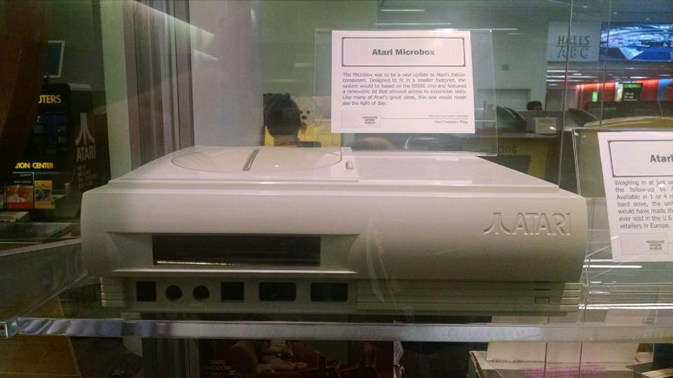{: width="600"}](microbox_cd.jpg)

*The CD-ROM case in the Microbox display of the Videogame History Museum ("From the Curt Vendel Collection")*

And then there is "Painter". In Aug 1993 ST-Computer asked Bob Gleadow of Atari UK whether Jaguar technology would go into new Atari computers - "there is said to be a development called Microbox" - and got only the answer that there was no official information.[^gleadow93] The Microbox page of atarimuseum.com is titled 'The Atari Microbox Codename: "Painter"' and says that "According to production documents for project "Painter" only 3 sample cases were made and shipped to Atari".[^amuseum] Atari Explorer tells a different story: "Painter" was a home computer based on the Jaguar, for which "As early as August 1992, the Atari R&D team headed by Richard Miller were sketching out plans" - and Richard Miller told them the project "was ill conceived from the start".[^aex] The same labelled picture of the CD-ROM case exists in both versions: on maedicke.de as "FALCON030 MICROBOX" with a "CD-ROM bay" and MIDI ports, on Atari Explorer as 'Project: "PAINTER"' with joystick ports and a "Comlynx Port" (ComLynx is the network port of the Atari Lynx).[^maedicke][^aex]

[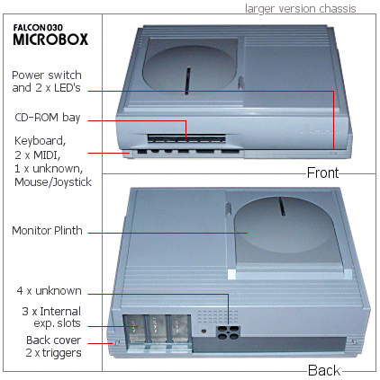](microbox_labels_maedicke.gif) [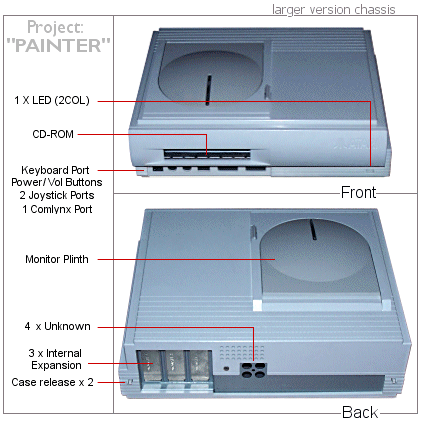](painter_labels_atari_explorer.gif)

*The same picture of the CD-ROM case, labelled on maedicke.de (left) and on Atari Explorer (right)*

The same case with a flat top instead of the plinth is the case of the Falcon040 on maedicke.de and the '"Painter" Home Computer Prototype' with a "JAGUAR POWERED" logo on Atari Explorer, whose Microbox page "currently believe[s]" that the CD-ROM version was for the 040.[^maedicke][^aex] Eric Smith's progress reports of Apr-Jun 1993 mention a "Painter meeting", "Painter hardware and software issues" and the "Painter BIOS", and in the week ending Jun 26 1993 the "Painter BIOS" and the "diagnostic cartridge ROM for Microbox" are two separate items.[^es] So the slim case is the Microbox - on Leonard Tramiel's authority - but whether Painter and the Microbox were one project, and which machine the CD-ROM case was made for, is still open. If the slim case was the Microbox, the CD-ROM case may well have been Painter or the Falcon040 rather than a second Microbox - yet the Videogame History Museum display, from Curt Vendel's collection, and maedicke.de both call it the Microbox.

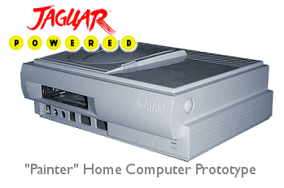

*The '"Painter" Home Computer Prototype' of Atari Explorer[^aex]*

Hans-Martin Krober, an Atari employee who has one of the prototype boxes, described the Falcon040 to atarihistory.de: it "was to come in a 'Sun-style' pizza box and was larger than the 'MicroBox'", and next to the 68040 it would have had an optional ethernet interface.[^ahs040] That fits ST Format's "brand new PC-looking case". Hans-Martin's box later went to Jason Smith, the owner of the floppy disk Microbox above: "Yes, this is it, the Falcon 040 prototype box. I received this directly from Hans Martin-Krober who confirmed it was a prototype of what would someday house the Falcon 040. Only one known to exist."[^jaysmith] It is a wide, flat desktop box with a 3.5" drive bezel on the left and an empty bay on the right, photographed on the same day as the Microbox, 20 minutes later.[^mbphotos]

[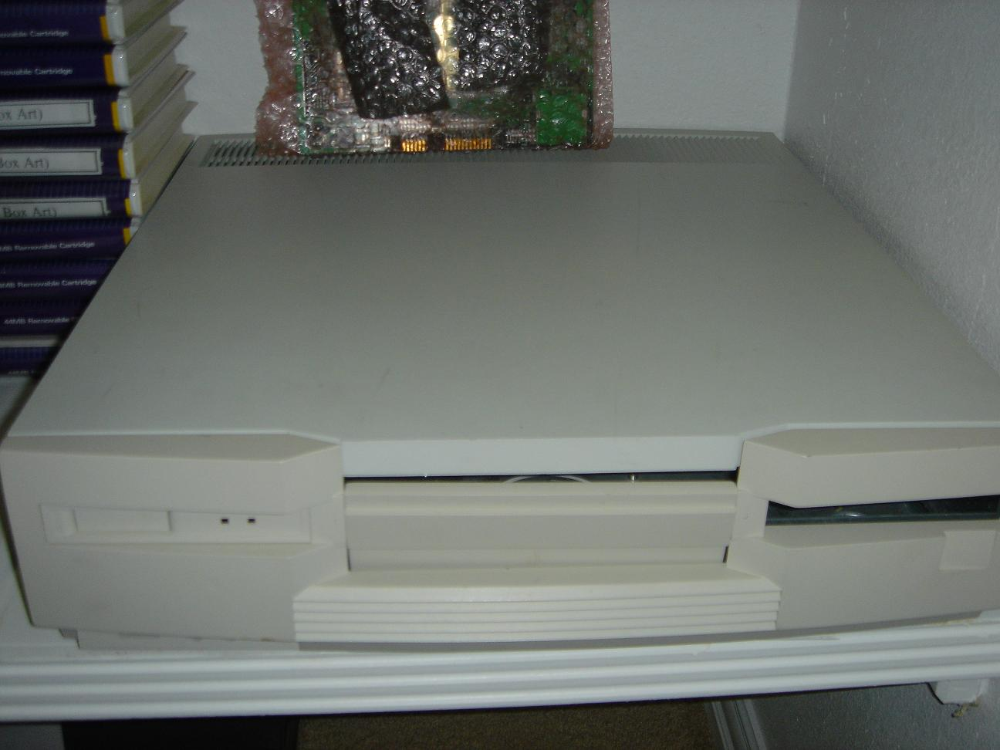{: width="480"}](falcon040_case.jpg)

*The Falcon040 prototype box from Hans-Martin Krober (Jason Smith's collection, Jul 4 2005)*

The Microbox was still being brought up in Jun'93, so it and the Falcon040 seem to have been in development in parallel for quite a while. Unfortunately, no machine was ever shown or previewed in 1993 or later...

#### 1993-1996: the Falcon030 after Atari

In the US the Falcon030 finally shipped in June 1993, in four configurations from $799 (1 MB, no hard disk) to $1899 (14 MB with an 80 MB hard disk), and only through some 140 authorized dealers who were allowed to sell it to customers in person - a limit Atari dropped only in early 1994.[^mcurrent] By then Atari's attention was elsewhere. The Jaguar was introduced in August 1993, the same month in which Atari counted 13,000 to 14,000 Falcon030s shipped in Europe, about 40% of them in Germany, with another 4164 waiting in the Dutch warehouse;[^gleadow93] Atari France alone sold some 6,000 of them in 1993.[^mcurrent]

The machine outlived its maker's interest in it. At the shareholders' meeting on Jun 17 1994 Sam Tramiel announced that Atari was licensing the Falcon030 technology to C-Lab in Germany, so that a professional audio and music workstation could be developed further, while Atari would keep building the Falcon030 as long as there was demand. In November 1994 C-Lab in Hamburg announced its worldwide licence to build audio workstations on the Falcon030 platform[^mcurrent] and presented the contract - "DONE DEAL!" in its advertising - at the proTOS show in Hennef at the end of the month. The exclusive licence allowed C-Lab to improve "the motherboard, the case or the operating system", and C-Lab's Burkhard Bürgerhoff was talking to the Falcon's manufacturer about continuing the production in Taiwan.[^clab94] The Falcon MK IIs at the Musikmesse in March 1995 were still Atari Falcons bought and converted by C-Lab - line level audio, better converters, the SCSI disk moved inside, 14 MB and a 514 MB disk for under 5000 DM - and the first series made for C-Lab was to come from EFA in Taiwan, which "had also produced the Falcons for Atari".[^clab95] The Falcon MK I followed in the summer of 1995,[^mcurrent] and the Falcon MKX, with a new desktop case and a PC keyboard, was introduced at proTOS in November 1995 and shipped in early 1996. Its upgrade service took Atari Falcon030s "from serial number Y43 upwards", and the exchange of the AD/DA converters was "necessary for every Falcon 030".[^mkx] 1996 was also the year in which Atari Corporation itself was merged into the disk drive maker JT Storage.[^mcurrent]

#### Who was who

As far as the documents tell:
- **John D. Horton Jr.** (Dallas): the contact of the "FALCON Design Team", the "SPARROW DMA II CKT" (1991), the SDMA and ADMA specifications (Jul 1992) and the FALCON040 product specification (Sep 1992)
- **Gideon Amir**: the head of Atari Computers Ltd. in Israel (1989 - 1992)
- **Jack**, **Sam** and **Leonard Tramiel**: Atari's chairman, president and software chief; Leonard ran the CeBIT '92 demo
- **Alwin Stumpf**: general manager of Atari Germany
- **Bob Gleadow**: managing director of Atari UK
- **Burkhard Bürgerhoff**: C-Lab, the Falcon MK machines
- **Moshe Segal** and **Eran Dariel** (Atari Israel): the Sparrow specification and its chip specifications, Moshe Segal also the 1991 "SPARROW MOTHERBOARD" and the "DMABRD" (as "S. Moshe"), Eran Dariel the VTG cook book
- **S. Rosenberg** ("ATARI COMPUTERS LTD."): the rev A2 "SPARROW BOARD" schematics (Jan 1992)
- **Marty Pennock** (Dallas product engineering): the weekly reports and the Sparrow / FALCON030 service guide
- **Tom Ulaszek** (Dallas): the addressee of the weekly reports, took the FALCON030 product specification to Taiwan
- **Roy Stedman**: the Sparrow / Falcon030 production diagnostics (Dec 1991 - Oct 1992) and the Falcon040 monitor F4MON (Mar - Jun 1992)
- **Tom Le**: the expansion port test fixture (Feb 1992), the diagnostics for the pilot Falcon030 boards (Aug 1992)
- **Toomey Freeman**: the Falcon 030 diagnostic specification (Mar 1992)
- **Jerry Smith**: the Falcon030 production procedure (Jul 1992), then in Taiwan
- **Richard Miller** (Sunnyvale): very likely the "RGM" of the FX-1 and Falcon030 hardware reference guides (Feb - May 1992); Atari's VP Technology, to whom Atari Israel reported; the Sparrow connector lists, worked on the Sparrow in Dallas; according to Atari Explorer the head of the R&D team which planned "Painter"
- **John Hoenig**, **Tracy Hall** (Sunnyvale[^wsummer]) and **Scott Matson**: the SDMA, schematic and chip specification changes of the Falcon030 (Jun - Jul 1992)
- **Tracy Hall**: at Atari from Oct 1989 to Dec 1992, senior design engineer of the STBook, STylus and Falcon030[^mcurrent]
- **Scott Lewis**: the Falcon040 MCU specification (Sep 1992)
- **Steven Chan** and **Ira Valenski**: mechanical design questions in the Falcon specification; according to atarimuseum.com, Ira Valenski headed the design team of the Microbox
- **Martin Brennan**: was to supply the Falcon's graphics coprocessor chapter
- **Allan Pratt** (TOS group): the Sparrow BIOS from Dec 1991 to May 1992, i.e. TOS 2.07
- **Ken Badertscher** (TOS group): GEMDOS changes such as Srealloc() and TOS 4.00 (1992)
- **Eric Smith** (TOS group): brought up the Microbox prototype, attended the Painter meetings (1993)
- **Hans-Martin Krober**: discussed the Painter BIOS with Eric Smith (Jun 1993), said that the Falcon040 case was entirely different
- **Leonard Tramiel**: gave a Microbox board to the Computer History Museum
- **Sam Tramiel** (Atari's chief executive officer) and **Bob Gleadow** (Atari UK's managing director): the Falcon and STE quotes of Jul 1991
- **Andy Hutchinson**: wrote both magazine articles quoted here

### Gallery

My collection of Sparrow photos is available as a gallery here: [Sparrow Gallery](gallery/index.html).

---

[^falconspec]: Falcon specification: the working draft of Dec 3 1991 ([PDF](falcon_specification_19911203.pdf), also TECHPUBS [WP/FALCON/FALCON.WP](techpubs/TECHPUBS_converted/WP/FALCON/FALCON.WP.txt)) and the Prototype B release of Aug 26 1992 ([markdown](falcon_specification_19920826.md), also TECHPUBS [WP/FALCON/FALCON.TXT](techpubs/TECHPUBS_converted/WP/FALCON/FALCON.TXT.txt)), in particular section 10 "Mechanical Considerations" and section 12 "Revisions".
[^ttspec]: TECHPUBS [PGSTREAM/TEXT/TTSPEC.TXT](techpubs/TECHPUBS_converted/PGSTREAM/TEXT/TTSPEC.TXT.txt): "Atari TT and TT/X Product Specifications", working draft of Mar 31 1989, compared to the Falcon specification.
[^nce91]: New Computer Express, Jul 13 1991, [page 4](91_falcon1.jpg) and [page 5](91_falcon2.jpg): cover feature "Atari is set to fly ... high with CD-I" by Andy Hutchinson, with the boxes "The Falcon: anatomy of a story..." and "How likely is an extended STE?".
[^sparrowspec]: [Sparrow specification (dated Dec 18 1991)](sparrow_specification_19911218.md), also TECHPUBS [WP/SPARROW/SPARROWS.TXT](techpubs/TECHPUBS_converted/WP/SPARROW/SPARROWS.TXT.txt): the rev A10 change list dated 10/22/91, the list without a heading which follows it, and sections 2 and 5.
[^israel]: TECHPUBS faxes from Atari Dallas to Atari Israel: PGSTREAM/FAX/ISRAEL1.DOC (Nov 25 1991; only in [TECHPUBS.zip](techpubs/TECHPUBS.zip)), [ISRAEL2.DOC](techpubs/TECHPUBS_converted/PGSTREAM/FAX/ISRAEL2.DOC.txt) (a new version of the first fax which kept its date line "November 25, 1991", saved on Jan 5 1992), [ISRAEL3.DOC](techpubs/TECHPUBS_converted/PGSTREAM/FAX/ISRAEL3.DOC.txt) (Jan 13 1992) and [ISRAEL4.DOC](techpubs/TECHPUBS_converted/PGSTREAM/FAX/ISRAEL4.DOC.txt) (Jan 28 1992), all to Moshe Segal.
[^sch91]: [Sparrow schematics of 1991](sparrow_schematics_19910312.pdf), title blocks: "SPARROW DMA II CKT", Atari Microsystems, number C302508, engineer John Horton, sheets 1 and 2 of Aug 26 1991 and sheet 3 of Sep 13 1991 (sheet 1 also has "ASSY DRAWING CA401196" and "FAB DRAWING C302509"); "DMABRD", Atari Israel, engineer S. Moshe, Apr 4 1991; "SPARROW MOTHERBOARD", Atari Israel, engineer M. Segal, sheets 2 and 3 of 5, Mar 12 1991.
[^sdma1991]: TECHPUBS [WP/SPARROW/SDMA.DOC](techpubs/TECHPUBS_converted/WP/SPARROW/SDMA.DOC.txt): "Sparrow DMA ASIC Description", Nov 4 1991; [WP/SPARROW/SDMA.TXT](techpubs/TECHPUBS_converted/WP/SPARROW/SDMA.TXT.txt) is the same text.
[^combo]: TECHPUBS [WP/SPARROW/COMBO.A07](techpubs/TECHPUBS_converted/WP/SPARROW/COMBO.A07.txt): "SPARROW - (SP) COMBO SPECIFICATION" rev A7 by Eran Dariel and Moshe Segal, Dec 19 1991.
[^videl]: TECHPUBS [WP/SPARROW/VIDEL.A05](techpubs/TECHPUBS_converted/WP/SPARROW/VIDEL.A05.txt): "SPARROW - (SP) VIDEO CHIP SPECIFICATION" rev A5 by Eran Dariel and Moshe Segal, Dec 19 1991.
[^vtg]: TECHPUBS [WP/SPARROW/COOKBOOK.VTG](techpubs/TECHPUBS_converted/WP/SPARROW/COOKBOOK.VTG.txt): "VTG Cook Book" rev A2 by Eran Dariel, Dec 12 1991.
[^diag]: TECHPUBS [WP/SPARROW/DIAGS](techpubs/#wp-sparrow-diags): Sparrow production diagnostics source code, version 1.12 of Jul 22 1992 (changelog from Dec 1991 in [VERSION.S](techpubs/TECHPUBS_converted/WP/SPARROW/DIAGS/VERSION.S.txt), author in [SPARROW.S](techpubs/TECHPUBS_converted/WP/SPARROW/DIAGS/SPARROW.S.txt), details in [INIT.S](techpubs/TECHPUBS_converted/WP/SPARROW/DIAGS/INIT.S.txt), [INIT2.S](techpubs/TECHPUBS_converted/WP/SPARROW/DIAGS/INIT2.S.txt), [EXCEP.S](techpubs/TECHPUBS_converted/WP/SPARROW/DIAGS/EXCEP.S.txt), [TIMER.S](techpubs/TECHPUBS_converted/WP/SPARROW/DIAGS/TIMER.S.txt), [DMA.S](techpubs/TECHPUBS_converted/WP/SPARROW/DIAGS/DMA.S.txt), [VIDEO.S](techpubs/TECHPUBS_converted/WP/SPARROW/DIAGS/VIDEO.S.txt), [VIDEO.DOC](techpubs/TECHPUBS_converted/WP/SPARROW/DIAGS/VIDEO.DOC.txt), [SDMA.S](techpubs/TECHPUBS_converted/WP/SPARROW/DIAGS/SDMA.S.txt), [CONSOLE.S](techpubs/TECHPUBS_converted/WP/SPARROW/DIAGS/CONSOLE.S.txt), [DSP.S](techpubs/TECHPUBS_converted/WP/SPARROW/DIAGS/DSP.S.txt), [KEYBD.S](techpubs/TECHPUBS_converted/WP/SPARROW/DIAGS/KEYBD.S.txt) and [GENTST.S](techpubs/TECHPUBS_converted/WP/SPARROW/DIAGS/GENTST.S.txt)).
[^dspboard]: TECHPUBS [EASYDRAW/SUNNYVAL/DSPBOARD.GEM](techpubs/TECHPUBS_converted/EASYDRAW/SUNNYVAL/DSPBOARD.GEM.svg): "DSP Board Orientation", Feb 24 1992 (a damaged file; an intact copy of the drawing is inside the damaged [EASYDRAW/SUNNYVAL/TTFLOW1.GEM](techpubs/TECHPUBS_converted/EASYDRAW/SUNNYVAL/TTFLOW1.GEM.txt)).
[^wdec]: TECHPUBS [PGSTREAM/WEEKLY/TOMU1212.DOC](techpubs/TECHPUBS_converted/PGSTREAM/WEEKLY/TOMU1212.DOC.txt) and [TOMU1219.DOC](techpubs/TECHPUBS_converted/PGSTREAM/WEEKLY/TOMU1219.DOC.txt): weekly reports, Dec 12 and Dec 19 1991.
[^wearly92]: TECHPUBS [PGSTREAM/WEEKLY/TOMJAN9.DOC](techpubs/TECHPUBS_converted/PGSTREAM/WEEKLY/TOMJAN9.DOC.txt), [TOMJAN16.DOC](techpubs/TECHPUBS_converted/PGSTREAM/WEEKLY/TOMJAN16.DOC.txt), [TOMJAN23.DOC](techpubs/TECHPUBS_converted/PGSTREAM/WEEKLY/TOMJAN23.DOC.txt), [TOMJAN30.DOC](techpubs/TECHPUBS_converted/PGSTREAM/WEEKLY/TOMJAN30.DOC.txt) and [TOMFEB06.DOC](techpubs/TECHPUBS_converted/PGSTREAM/WEEKLY/TOMFEB06.DOC.txt): weekly reports, Jan 9 - Feb 6 1992.
[^spcon]: TECHPUBS [PGSTREAM/F030/SPCON.DOC](techpubs/TECHPUBS_converted/PGSTREAM/F030/SPCON.DOC.txt): fax to Richard Miller with the Sparrow connector pinouts, Jan 29 1992.
[^miller]: TECHPUBS [PGSTREAM/FAX/RICHARD1.DOC](techpubs/TECHPUBS_converted/PGSTREAM/FAX/RICHARD1.DOC.txt) and [RICHARD2.DOC](techpubs/TECHPUBS_converted/PGSTREAM/FAX/RICHARD2.DOC.txt) (faxes to Richard Miller, Jan 30 1992) and [PGSTREAM/FAX/RICHARD3.DOC](techpubs/TECHPUBS_converted/PGSTREAM/FAX/RICHARD3.DOC.txt) (memo to Richard Miller, Mar 4 1992); the TT030 memo [PGSTREAM/TT030/TT30MEMO.DOC](techpubs/TECHPUBS_converted/PGSTREAM/TT030/TT30MEMO.DOC.txt) (Oct 29 1991) lists "Richard Miller - SUVL".
[^drawings]: TECHPUBS DYNACADD/PARTS/DXF/STEUPPER.DXF and STERIGHT.DXF (STE case, Sep 23 1991; only in [TECHPUBS.zip](techpubs/TECHPUBS.zip)) and their copies with labels [STEPUP.DXF](techpubs/TECHPUBS_converted/DYNACADD/PARTS/DXF/STEPUP.DXF.svg), [STEPRT.DXF](techpubs/TECHPUBS_converted/DYNACADD/PARTS/DXF/STEPRT.DXF.svg) and [STEPLFT.DXF](techpubs/TECHPUBS_converted/DYNACADD/PARTS/DXF/STEPLFT.DXF.svg) (STE+) compared to [EASYDRAW/SPARUPA.GEM](techpubs/TECHPUBS_converted/EASYDRAW/SPARUPA.GEM.svg) (Feb 6 1992), [EASYDRAW/SPARRT.GEM](techpubs/TECHPUBS_converted/EASYDRAW/SPARRT.GEM.svg) (Feb 7 1992), [EASYDRAW/SPARROWL.GEM](techpubs/TECHPUBS_converted/EASYDRAW/SPARROWL.GEM.svg) (Apr 9 1992; as DYNACADD/PARTS/DXF/SPARROWL.DXF already on Feb 7 1992) and [DYNACADD/PARTS/DXF/SPARROWR.DXF](techpubs/TECHPUBS_converted/DYNACADD/PARTS/DXF/SPARROWR.DXF.svg) (Feb 7 1992); the STE+ quotes are from its service manual, rough draft of Nov 12 1991, [PGSTREAM/STEPLUS/STEPCH1.DOC](techpubs/TECHPUBS_converted/PGSTREAM/STEPLUS/STEPCH1.DOC.txt).
[^tosdec91]: TOS4X commits [4b7355df](https://github.com/mikrosk/tos4x/commit/4b7355df88912746232f3408f8032c94027b87c2) (bios/makefile 2.14, Allan Pratt, Dec 4 1991) and [fa94c235](https://github.com/mikrosk/tos4x/commit/fa94c235624da0049a72f5321e54eb26a12b01ba) (bios/switches/switches.wou, Dec 4 1991).
[^fx1]: TECHPUBS [PGSTREAM/F030/HWREF.BAK](techpubs/TECHPUBS_converted/PGSTREAM/F030/HWREF.BAK.txt) and [PGSTREAM/F030/HWREF.DOC](techpubs/TECHPUBS_converted/PGSTREAM/F030/HWREF.DOC.txt): "FX-1 Hardware reference guide" v0.3 (Feb 16 1992) and v0.4 (Feb 18 1992).
[^sch92]: [Sparrow schematics of Jan 19 1992](sparrow_schematics_19920119.pdf), title blocks of all ten sheets: "ATARI COMPUTERS LTD.", "SPARROW BOARD", rev A2, engineer S. Rosenberg, "1-19-1992".
[^connectors]: TECHPUBS [EASYDRAW/SUNNYVAL/MEMORY50.GEM](techpubs/TECHPUBS_converted/EASYDRAW/SUNNYVAL/MEMORY50.GEM.svg), [MEMORY30.GEM](techpubs/TECHPUBS_converted/EASYDRAW/SUNNYVAL/MEMORY30.GEM.svg), [EXPAND50.GEM](techpubs/TECHPUBS_converted/EASYDRAW/SUNNYVAL/EXPAND50.GEM.svg) and [EXPAND30.GEM](techpubs/TECHPUBS_converted/EASYDRAW/SUNNYVAL/EXPAND30.GEM.svg): "SPARROW MEMORY CONNECTOR" and "SPARROW EXPANSION CONNECTOR", Feb 20 1992.
[^f030prod]: TECHPUBS [PGSTREAM/F030/F030PROD](techpubs/#pgstream-f030-f030prod): "FALCON030 Hardware Product Specification" C302550-001 rev B, Aug 10 1992.
[^diagspec]: TECHPUBS [PGSTREAM/F030/DIAGNOST.3_3](techpubs/TECHPUBS_converted/PGSTREAM/F030/DIAGNOST.3_3.txt): "FALCON 030 DIAGNOSTIC SPECIFICATION", preliminary version 00 by Toomey Freeman, Mar 3 1992, with the "FALCON 30 Expansion Test fixture Specification" by Tom Le, Feb 28 1992.
[^psu]: TECHPUBS [PGSTREAM/TEXT/PSU117R4.TXT](techpubs/TECHPUBS_converted/PGSTREAM/TEXT/PSU117R4.TXT.txt) and [PGSTREAM/F030/PSU117R4.DOC](techpubs/TECHPUBS_converted/PGSTREAM/F030/PSU117R4.DOC.txt): "117 VAC SPARROW PSU SPECIFICATION", revisions REV1 (Feb 29 1992) to REV4 (May 18 1992).
[^f030serv]: TECHPUBS [PGSTREAM/F030/F030SERV](techpubs/#pgstream-f030-f030serv): "FALCON030 Service Guide" C303062-001, Oct 1 1992 (parts list in [F0307.DOC](techpubs/TECHPUBS_converted/PGSTREAM/F030/F030SERV/F0307.DOC.txt)).
[^devkit]: TECHPUBS [PGSTREAM/FALC030/INTRO.DOC](techpubs/TECHPUBS_converted/PGSTREAM/FALC030/INTRO.DOC.txt), [GL_MTOS.DOC](techpubs/TECHPUBS_converted/PGSTREAM/FALC030/GL_MTOS.DOC.txt) and [GL_GAMES.DOC](techpubs/TECHPUBS_converted/PGSTREAM/FALC030/GL_GAMES.DOC.txt): developer documentation, all dated Apr 23 1992.
[^tos207]: TOS4X tag [build/tos207](https://github.com/mikrosk/tos4x/tree/build/tos207) (byte-exact build of TOS 2.07): [bios/version.s](https://github.com/mikrosk/tos4x/blob/build/tos207/bios/version.s) (date $02291992), [bios/startup.s](https://github.com/mikrosk/tos4x/blob/build/tos207/bios/startup.s) (version x.07, cookies) and [build/TOS.JOB](https://github.com/mikrosk/tos4x/blob/build/tos207/build/TOS.JOB); release commit [dfb976ef](https://github.com/mikrosk/tos4x/commit/dfb976efca8497318c3114a48d9a2dd1b098beb4).
[^hardnote]: TECHPUBS [PGSTREAM/FALC030/HARDNOTE.DOC](techpubs/TECHPUBS_converted/PGSTREAM/FALC030/HARDNOTE.DOC.txt): "Falcon030 Developer Hardware Release Notes", Apr 29 1992.
[^f030hard]: TECHPUBS [PGSTREAM/TEXT/F030HARD.TXT](techpubs/TECHPUBS_converted/PGSTREAM/TEXT/F030HARD.TXT.txt) and [PGSTREAM/FALC030/HARDWARE.DOC](techpubs/TECHPUBS_converted/PGSTREAM/FALC030/HARDWARE.DOC.txt): "Falcon030 Hardware Reference Guide" v1.0a by "RGM", May 11 1992.
[^tos68030]: TOS4X commits [35a12891](https://github.com/mikrosk/tos4x/commit/35a1289111644314b34dfe6204743cf6b89734a0) (bios/makefile 2.16), [456e3f1b](https://github.com/mikrosk/tos4x/commit/456e3f1bbce6aac6e56b801ea1f1fc8c2e09a358) (bios.s 2.48), [785d1223](https://github.com/mikrosk/tos4x/commit/785d12237b1e4a331178b41a2bbcbd1f5ac393cf) (clock.s 2.21) and [0fb3d9e2](https://github.com/mikrosk/tos4x/commit/0fb3d9e22762367baff2bc3d091d088626042184) (startup.s 2.95), all May 18 1992, and [617800c1](https://github.com/mikrosk/tos4x/commit/617800c1c4a64a961b19ca83f4cd61908eb083ac) (startup.s 2.96, May 20 1992, RCS name OKSPARROW): Allan Pratt's last BIOS check-ins.
[^wsummer]: TECHPUBS [PGSTREAM/WEEKLY/TOMJUN11.DOC](techpubs/TECHPUBS_converted/PGSTREAM/WEEKLY/TOMJUN11.DOC.txt), [TOMJUN18.DOC](techpubs/TECHPUBS_converted/PGSTREAM/WEEKLY/TOMJUN18.DOC.txt), [TOMJUN25.DOC](techpubs/TECHPUBS_converted/PGSTREAM/WEEKLY/TOMJUN25.DOC.txt), [TOMJUL09.DOC](techpubs/TECHPUBS_converted/PGSTREAM/WEEKLY/TOMJUL09.DOC.txt), [TOMJUL16.DOC](techpubs/TECHPUBS_converted/PGSTREAM/WEEKLY/TOMJUL16.DOC.txt), [TOMJUL23.DOC](techpubs/TECHPUBS_converted/PGSTREAM/WEEKLY/TOMJUL23.DOC.txt) (its header says "July 16, 1992" but its items are from Jul 16-22), [TOMJUL30.DOC](techpubs/TECHPUBS_converted/PGSTREAM/WEEKLY/TOMJUL30.DOC.txt) and [TOMAUG13.DOC](techpubs/TECHPUBS_converted/PGSTREAM/WEEKLY/TOMAUG13.DOC.txt) (weekly reports, Jun - Aug 1992) and [PGSTREAM/MEMO/TOMSPARQ.DOC](techpubs/TECHPUBS_converted/PGSTREAM/MEMO/TOMSPARQ.DOC.txt) (memo to Tom Ulaszek, Jul 13 1992).
[^falcon040]: TECHPUBS [PGSTREAM/FALCON/FALSCHED.DOC](techpubs/TECHPUBS_converted/PGSTREAM/FALCON/FALSCHED.DOC.txt) (Feb 3 1992) and weekly reports [PGSTREAM/WEEKLY/TOMJUN11.DOC](techpubs/TECHPUBS_converted/PGSTREAM/WEEKLY/TOMJUN11.DOC.txt), [TOMJUL09.DOC](techpubs/TECHPUBS_converted/PGSTREAM/WEEKLY/TOMJUL09.DOC.txt), [TOMAUG13.DOC](techpubs/TECHPUBS_converted/PGSTREAM/WEEKLY/TOMAUG13.DOC.txt), [TOMSEP10.DOC](techpubs/TECHPUBS_converted/PGSTREAM/WEEKLY/TOMSEP10.DOC.txt) and [TOMSEP17.DOC](techpubs/TECHPUBS_converted/PGSTREAM/WEEKLY/TOMSEP17.DOC.txt) (Jun - Sep 1992).
[^srealloc]: TOS4X [gemdos/mem.c](https://github.com/mikrosk/tos4x/blob/master/gemdos/mem.c): xsrealloc(), "920709 kbad".
[^sdma]: TECHPUBS [WP/SPARROW/SDMA.TXT](techpubs/TECHPUBS_converted/WP/SPARROW/SDMA.TXT.txt) (the text of Nov 4 1991) compared to [PGSTREAM/TEXT/SDMA.TXT](techpubs/TECHPUBS_converted/PGSTREAM/TEXT/SDMA.TXT.txt) (undated, file of Jul 30 1992); the pin counts are those of their pin lists.
[^rev3]: TECHPUBS [WP/SPARROW/DIAGS/SPARROW3.DOC](techpubs/TECHPUBS_converted/WP/SPARROW/DIAGS/SPARROW3.DOC.txt): "Problems with rev. 3 board", Roy Stedman, Jul 10 1992, and [GENTST.S](techpubs/TECHPUBS_converted/WP/SPARROW/DIAGS/GENTST.S.txt): "Worked on Falcon030, rev 3, with new keyboard."
[^mfg]: TECHPUBS [PGSTREAM/MFG_PROC](techpubs/#pgstream-mfg-proc): "FALCON 030 PRODUCTION PROCEDURE" C302758-001, revision 1 draft, Jul 15 1992.
[^bezel]: TECHPUBS [EASYDRAW/F030RGHT.GEM](techpubs/TECHPUBS_converted/EASYDRAW/F030RGHT.GEM.svg) (Jul 23 1992) and [DYNACADD/PARTS/F030/F030RGHT.DPT](techpubs/TECHPUBS_converted/DYNACADD/PARTS/F030/F030RGHT.DPT.svg) (Jul 24 1992) compared to [DYNACADD/PARTS/DXF/STEPRT.DXF](techpubs/TECHPUBS_converted/DYNACADD/PARTS/DXF/STEPRT.DXF.svg); [PGSTREAM/GRAPHICS/F030LEFT.GEM](techpubs/TECHPUBS_converted/PGSTREAM/GRAPHICS/F030LEFT.GEM.svg) (Jun 10 1992) is [EASYDRAW/SPARROWL.GEM](techpubs/TECHPUBS_converted/EASYDRAW/SPARROWL.GEM.svg).
[^bom]: [Microbox bill of materials](microbox_bom_19930205.txt), dated 02-05-1993.
[^f030assy]: TECHPUBS [DYNACADD/PARTS/DXF/401280D1.DXF](techpubs/TECHPUBS_converted/DYNACADD/PARTS/DXF/401280D1.DXF.svg) ("ASSY TOP CASE FALCON030"), [401333D1.DXF](techpubs/TECHPUBS_converted/DYNACADD/PARTS/DXF/401333D1.DXF.svg) ("ASSY, SHIPPING, FALCON030"), [401342D1.DXF](techpubs/TECHPUBS_converted/DYNACADD/PARTS/DXF/401342D1.DXF.svg) ("ASSY ACCESSORY PACK") and [401337D1.DXF](techpubs/TECHPUBS_converted/DYNACADD/PARTS/DXF/401337D1.DXF.svg) ("ASSY, SPEAKER"), Jun - Jul 1992.
[^tos400]: TOS4X commit [a46f7077](https://github.com/mikrosk/tos4x/commit/a46f7077e2d223be3b55efbf54d748cf0c464e60) (Ken Badertscher, Aug 10 1992; RCS name TOS0400) and tag [build/tos400](https://github.com/mikrosk/tos4x/tree/build/tos400) ([bios/version.s](https://github.com/mikrosk/tos4x/blob/build/tos400/bios/version.s): $08111992).
[^pennock]: TECHPUBS [PGSTREAM/WEEKLY/TOMSEP24.DOC](techpubs/TECHPUBS_converted/PGSTREAM/WEEKLY/TOMSEP24.DOC.txt): weekly report, Sep 24 1992.
[^tos40x]: TOS4X bios/version.s of the tags [build/tos401](https://github.com/mikrosk/tos4x/blob/build/tos401/bios/version.s) ($10021992), [build/tos402](https://github.com/mikrosk/tos4x/blob/build/tos402/bios/version.s) ($01261993) and [build/tos404](https://github.com/mikrosk/tos4x/blob/build/tos404/bios/version.s) ($03081993).
[^falconsg]: TECHPUBS [WP/FALCON/FALCON1.TXT](techpubs/TECHPUBS_converted/WP/FALCON/FALCON1.TXT.txt): Falcon service guide draft, section one, file of Jan 27 1992.
[^falconasic]: TECHPUBS [PGSTREAM/TEXT/IO.TXT](techpubs/TECHPUBS_converted/PGSTREAM/TEXT/IO.TXT.txt) ("Design specification for the FALCON IO controller") and [PGSTREAM/TEXT/DMA.TXT](techpubs/TECHPUBS_converted/PGSTREAM/TEXT/DMA.TXT.txt) ("Design specification for the FALCON DMAC"), undated, files of Feb 14 1992.
[^adma]: TECHPUBS [PGSTREAM/TEXT/ADMA.TXT](techpubs/TECHPUBS_converted/PGSTREAM/TEXT/ADMA.TXT.txt): "Falcon-A DMA ASIC Description", Jul 1992.
[^tosmake]: TOS4X [bios/makefile](https://github.com/mikrosk/tos4x/blob/master/bios/makefile) (revision 2.18, "920702 kbad"), lines 8, 175 and 178.
[^f040pcb]: [Falcon040 stencil](falcon040.png): title block "ATARI / 4115 KELLER SPRINGS RD #200 / DALLAS, TEXAS 75244" and "FALCON 040 / C302697-001 / REV 2".
[^memboards]: TECHPUBS [DYNACADD/PARTS/DXF/401292D4.DXF](techpubs/TECHPUBS_converted/DYNACADD/PARTS/DXF/401292D4.DXF.svg) and [401294D4.DXF](techpubs/TECHPUBS_converted/DYNACADD/PARTS/DXF/401294D4.DXF.svg): "PCB ASSY DRAWING, 1/4 MEG EXPANSION" (CA401292) and "14 MEG EXPANSION" (CA401294).
[^pcbno]: TECHPUBS [PGSTREAM/MFG_PROC/SP_MFG_3.DOC](techpubs/TECHPUBS_converted/PGSTREAM/MFG_PROC/SP_MFG_3.DOC.txt): incoming inspection list of the Falcon030 production procedure ("C302763-001 1/4 MEG PCB", "C302767-001 14 MEG PCB", "C303006-001 FALCON 030 PCB"), file of Jul 20 1992; [PGSTREAM/ATBS/TT300005.DOC](techpubs/TECHPUBS_converted/PGSTREAM/ATBS/TT300005.DOC.txt): technical bulletin TT30-0005 (main PCB "FAB" C301763-001 and C302406-001), Apr 2 1992.
[^aex]: Atari Explorer (mirror of atari-explorer.com): ["Microbox uncovered"](https://atari-explorer.ctrl-alt-rees.com/falcon/microbox.html) (picture "FALCON 030 MICROBOX", update of Jan 2005), ["Painter"](https://atari-explorer.ctrl-alt-rees.com/protos/protos-painter.html) (pictures '"Painter" Home Computer Prototype' and 'Project: "PAINTER"') and ["Falcon040"](https://atari-explorer.ctrl-alt-rees.com/protos/protos-falcon040.html) (picture "Falcon040 Motherboard (AHS Collection)"); these pictures were archived from atari-explorer.com in Dec 2005 - Jan 2006.
[^maedicke]: maedicke.de, "Die Atari Prototypen": [Atari Microbox](https://web.archive.org/web/20221208131609/https://www.maedicke.de/atari/hardware/microbox.htm) (with the labelled picture "FALCON030 MICROBOX") and [Atari Falcon 040](https://web.archive.org/web/20221209063752/https://www.maedicke.de/atari/hardware/falcon040.htm) (board and case photos), copies archived in Dec 2022.
[^stf41]: [ST Format 41](atari-st-format-issue-041_11.jpg) (Dec 1992), page 11: "Falcon040 boosts new Atari family" by Andy Hutchinson.
[^amuseum]: ["The Atari Microbox"](https://atarimuseum.ctrl-alt-rees.com/computers/16bits/falcon030/microbox/index.htm) at atarimuseum.com (mirror; the same text was archived from www.atarimuseum.com on [Dec 19 2003](https://web.archive.org/web/20031219124957/http://www.atarimuseum.com/computers/16bits/falcon030/microbox/index.htm)).
[^mbpcb]: [Microbox gerber file](microbox_gerber.pdf) (printouts of Apr 7 2002: "ASSY. DRAWING FALCON030/MICROBOX" rev 1, sheet 1 of 2; "FAB DRAWING FALCON030/MICROBOX" rev 1; the solder side; the drill plot "Af1452") and [Microbox PCB](microbox-pcb-color.pdf) (the layers "AF1452 ATARI SILK COMP SIDE", "AF1452 COMP SIDE", "+5V", "GND", "CIRCUIT SIDE", "AF1452 SILK CIRCUIT SIDE" and others).
[^chm]: Computer History Museum catalogue: ["Falcon 030 Microbox board"](https://www.computerhistory.org/collections/catalog/102672949) and ["Falcon Microbox Case Prototype"](https://www.computerhistory.org/collections/catalog/102673488), both acquisition number X3106.2005.
[^es]: [Eric Smith's progress reports](http://www.atarimania.com/utility-atari-st-multitos_29227.html) at atarimania.com, weeks ending Apr 17, May 1, Jun 12 and Jun 26 1993.
[^mbphotos]: Photos [microbox_floppy.jpg](microbox_floppy.jpg) (EXIF: Sony DSC-T1, 2005:07:04 11:03:41) and [falcon040_case.jpg](falcon040_case.jpg) (Sony DSC-T1, 2005:07:04 11:23:46), the same pictures as DSC01170 and DSC01198 on Jason Smith's collector page, [microbox_cd.jpg](microbox_cd.jpg) (Microbox display of the Videogame History Museum) and [microbox_cd1.jpg](microbox_cd1.jpg), [microbox_cd2.jpg](microbox_cd2.jpg) and [microbox_cd3.jpg](microbox_cd3.jpg) (the same files as microbox1.jpg - microbox3.jpg of atarimuseum.com's Microbox page).
[^jaysmith]: Jason Smith, ["Atari Collector's Corner"](https://web.archive.org/web/20061024165427/http://www.jaysmith2000.com/collector.html) at jaysmith2000.com (archived Oct 24 2006): "Atari Falcon Microbox" and "Atari Falcon 040".
[^mcurrent]: Michael Current, ["A History of Tramel Technology / Atari"](https://mcurrent.name/atarihistory/tramel_technology.html), a timeline compiled from magazines and other sources (for the entries used here: Current Notes, ST Review, the New York Times and Atari's own announcements).
[^f4mon]: Source code of the Falcon040 monitor (version history Mar 10 - Jun 9 1992) with Roy Stedman's "FALCON PROGRAMMING NOTES" (Apr 14 - Jun 1 1992) and the "XGA Dawn" demo (Mar 9 1992); not publicly available.
[^rws040]: Personal communication from the person who provided the diagnostic sources of version 1.25 (including the 68040/68030 monitor), about their conversations with Roy Stedman.
[^dallas]: ST-Computer 5/1990, [interview with Alwin Stumpf](https://www.stcarchiv.de/st-computer/1990/05/alwin-stumpf-im-interview); TOS 5/1991, [editorial](https://www.stcarchiv.de/tos/1991/05/editorial); TOS 10/1990, [Computer 91](https://www.stcarchiv.de/tos/1990/10/computer91) (all quotes translated from German).
[^cebit92]: TOS 4/1992, [CeBIT 1992: Sparrow](https://www.stcarchiv.de/tos/1992/04/cebit1992-sparrow); ST-Computer 5/1992, [CeBIT 1992](https://www.stcarchiv.de/st-computer/1992/05/cebit-1992); TOS 5/1992, [interview with Jack Tramiel](https://www.stcarchiv.de/tos/1992/05/interview-mit-jack-tramiel) (quotes translated from German).
[^stm1292]: ST-Magazin 12/1992, [Falcon 030](https://www.stcarchiv.de/st-magazin/1992/12/falcon-030).
[^devcon92]: ST-Magazin 9/1992, [AtariEuroDevCon](https://www.stcarchiv.de/st-magazin/1992/09/atarieurodevcon) (translated from German).
[^isr5]: TECHPUBS [PGSTREAM/FAX/ISRAEL5.DOC](techpubs/TECHPUBS_converted/PGSTREAM/FAX/ISRAEL5.DOC.txt): fax to Eran Dariel and Moshe Segal, Aug 3 1992.
[^frankfurt92]: TOS 9/1992, [Falcon030: Der Falke ist gelandet](https://www.stcarchiv.de/tos/1992/09/falcon030); ST-Computer 9/1992, [Falcon 030: erste offizielle Leistungsdaten](https://www.stcarchiv.de/st-computer/1992/09/falcon-030-erste-offizielle-leistungsdaten) (translated from German).
[^messe92]: ST-Computer 10/1992, [Atari Messe 1992](https://www.stcarchiv.de/st-computer/1992/10/atari-messe-1992); TOS 10/1992, [interview with Sam Tramiel](https://www.stcarchiv.de/tos/1992/10/sam-tramiel-interview) (translated from German).
[^stuser81]: [Atari ST User 81](http://www.atarimania.com/mags/hi_res/atari-st-user-issue-081_9.jpg) (Nov 1992), page 9.
[^tos393]: TOS 3/1993, [interview with Jack Tramiel](https://www.stcarchiv.de/tos/1993/03/interview-mit-jack-tramiel) (translated from German).
[^tos392]: TOS 3/1992, [editorial](https://www.stcarchiv.de/tos/1992/03/editorial) (translated from German).
[^lt2001]: ST-Computer 11/2001, [interview with Leonard Tramiel](https://www.stcarchiv.de/st-computer/2001/11/leonard-tramiel-interview) (translated from German).
[^gleadow93]: ST-Computer 10/1993, [interview with Bob Gleadow](https://www.stcarchiv.de/st-computer/1993/10/interview-atari-bob-gleadow) (translated from German).
[^clab94]: Atari Inside 5/1995, [Interview: Zukunft des Falcon](https://www.stcarchiv.de/atari-inside/1995/05/interview-zukunft-des-falcon) (translated from German).
[^clab95]: ST-Computer 5/1995, [Sylvies Tratschecke](https://www.stcarchiv.de/st-computer/1995/05/sylvies-tratschecke) (translated from German).
[^mkx]: ST-Computer 1/1996, [proTOS 1995](https://www.stcarchiv.de/st-computer/1996/01/protos1995); ST-Computer 3/1996, [News](https://www.stcarchiv.de/st-computer/1996/03/news) (translated from German).
[^ahs040]: atarihistory.de, ["The Atari 'Falcon040'"](https://atarihistory.de/html/computers/falcon040.htm).
